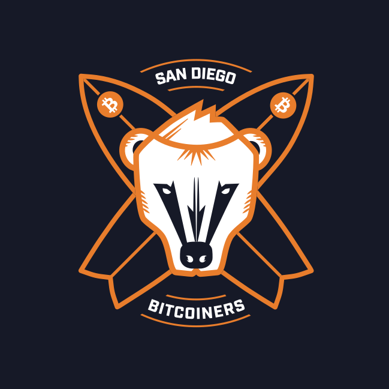

# StartOS Service Directory

**Jump to:** [Registries (12)](#registries) · [Services on a registry (243)](#services-on-a-registry) · [Services not on any registry (166)](#services-not-on-any-registry)

> [!TIP]
> Looking for something? Use your browser's Find (**Ctrl+F**, or **⌘F** on a Mac) and type a service name, a registry name, a category, or a word like *bitcoin* or *photos*.

A list of every StartOS service I could find: what registry it is on, where its packaging code
lives, which open-source project it wraps, and which paid product it is an alternative to.

> [!WARNING]
> **Nothing on this list has been vetted, audited, tested, or approved — by me, by Start9, or by
> anyone else.** This is a list of what turned up when I searched registries and GitHub. It is not
> a recommendation. Any package can contain malware or simply be broken, and a package from a
> third-party registry or a GitHub repository runs on your server with whatever access you grant
> it. Read the code, check who signed the package, and decide for yourself before installing
> anything. Read the full [disclaimer](DISCLAIMER.md).

This project is not affiliated with or endorsed by Start9 Labs. "StartOS" is a name used by
Start9 Labs; the names of other products appear only to identify them.

## How the list is built

- **Registries.** Each registry in [`registries.toml`](registries.toml) is asked for its package
  index. Name, description, package repo and upstream repo come from what each package declares
  about itself in its manifest. They are not checked against anything else.
- **Code hosts.** [GitHub](https://github.com), [GitLab](https://gitlab.com) and
  [Codeberg](https://codeberg.org) are searched for public repositories named `*-startos`. That
  adds packages that aren't on any registry, as long as they target StartOS 0.4 and were pushed to
  in the last 12 months. Know of another public code host worth searching? Open an issue.
- **Upstream project and "open-source alternative to"** are recorded for every service in
  [`data/services.json`](data/services.json) but left out of the tables below to keep them
  narrow. The alternative-to entries are written by hand in [`curated.toml`](curated.toml) and are
  opinion, not a feature-for-feature claim.
- A scheduled GitHub Action reruns the refresh weekly and opens a pull request with any changes.
  Changes reach the list only after a person reviews and merges them.

## Using a registry from this list

In StartOS, open **System → Registries** (or the gear in the registry selector above the
Marketplace search field), click **Add registry**, and enter the address shown below.

**Adding a registry trusts its signing keys.** StartOS adds the keys a new registry offers to
**System → Trusted Keys** as trusted for packages. Only add a registry whose operator you trust,
and review its keys there afterwards. Start9 says the same: it does not vet, endorse or support
services from custom registries.

## Corrections, additions and removals

Open an issue or pull request. Package and registry maintainers who want their entry changed or
removed: open an issue and it will be handled promptly. Don't edit `README.md` directly; it is
generated by `scripts/refresh.py` from `data/` and `curated.toml`.

_List generated 2026-11-20._

## Registries

Every StartOS registry this project knows of. Registry operators can add theirs by pull request; see [CONTRIBUTING.md](CONTRIBUTING.md). Being listed means only that the registry exists. **No registry is vetted or endorsed**, and adding one to StartOS trusts its signing keys.

_Table as of 2026-11-20. ⚠️ the registry did not answer at the last check (last known data kept). <kbd>S9</kbd> run by Start9 · <kbd>3rd</kbd> run by a third party. Svcs: services installable from it. Categories: services in each, as the registry assigns them._

| &nbsp;&nbsp;&nbsp;&nbsp;&nbsp;Icon&nbsp;&nbsp;&nbsp;&nbsp;&nbsp; | Registry Name | Trusted signers | Svcs | Categories |
|---|---|---|---|---|
| <kbd></kbd> | <kbd>S9</kbd> **Start9 Registry** [https://registry.start9.com/](https://registry.start9.com/) The primary registry for StartOS, run by Start9. Every service here is **maintained**, **recommended**, and **supported** by Start9. | Start9, drbonez, matthill | 95 | AI&nbsp;(5), Bitcoin&nbsp;(18), Developer&nbsp;Tools&nbsp;(5), Files&nbsp;and&nbsp;Productivity&nbsp;(39), Finance&nbsp;(4), Media&nbsp;(14), Networking&nbsp;(6), Nostr&nbsp;(2), Social&nbsp;(13) |
| <kbd></kbd> | <kbd>S9</kbd> **Start9 Beta Registry** [https://beta-registry.start9.com/](https://beta-registry.start9.com/) Pre-release builds of the services in the Start9 Registry. Report what you find in the [service testing room](https://matrix.to/#/#dev-service-testing:matrix.start9labs.com) on Matrix. | Start9, drbonez, matthill | 97 | — |
| <kbd></kbd> | <kbd>S9</kbd> **Start9 Community Registry** [https://community-registry.start9.com/](https://community-registry.start9.com/) The open registry for StartOS. Each service is maintained by its own developer. To list a service of your own, follow the [packaging guide](https://docs.start9.com/packaging); help is in the [service packaging room](https://matrix.to/#/#dev-service-packaging:matrix.start9labs.com) on Matrix. | Start9, drbonez, matthill | 100 | AI&nbsp;(7), Bitcoin&nbsp;(41), Crypto&nbsp;(13), Files&nbsp;and&nbsp;Productivity&nbsp;(17), Finance&nbsp;(2), Media&nbsp;(7), Networking&nbsp;(7), Nostr&nbsp;(8), Social&nbsp;(5) |
|  | <kbd>S9</kbd> **Start9 Community Beta Registry** [https://community-beta-registry.start9.com/](https://community-beta-registry.start9.com/) Pre-release builds of the services in the Community Registry. Report what you find in the [service testing room](https://matrix.to/#/#dev-service-testing:matrix.start9labs.com) on Matrix. | Github Actions, Start9, drbonez, matthill | 108 | — |
| <kbd></kbd> | <kbd>3rd</kbd> **PaulsCode** [https://start9.paulscode.com/](https://start9.paulscode.com/) _No description provided by the registry owner._ | — | 21 | AI&nbsp;(2), Bitcoin&nbsp;(14), Data&nbsp;(1), Developer&nbsp;Tools&nbsp;(2), Featured&nbsp;(13), Lightning&nbsp;(2) |
| <kbd></kbd> | <kbd>3rd</kbd> **registry.testnet4.info** [https://registry.testnet4.info/](https://registry.testnet4.info/) Maintained by [remcoros](https://github.com/remcoros). Personal StartOS registry with general services and testnet4 packages. Support is best-effort through the issue tracker linked by each package. | github.com/remcoros | 15 | Bitcoin&nbsp;(11), Mining&nbsp;(2), Networking&nbsp;(2), Testnet&nbsp;4&nbsp;(2), Wallets&nbsp;(3) |
| <kbd></kbd> | <kbd>3rd</kbd> **Atoll Registry** [https://start9.bobodread.com/](https://start9.bobodread.com/) _No description provided by the registry owner._ | — | 11 | AI&nbsp;(2), Files&nbsp;and&nbsp;Productivity&nbsp;(3), Lighting&nbsp;(1), Media&nbsp;(1), Networking&nbsp;(1) |
| <kbd></kbd> | <kbd>3rd</kbd> **start9.mempool.guide** [https://start9.mempool.guide/](https://start9.mempool.guide/) _No description provided by the registry owner._ | horizon, kyle | 8 | Bitcoin&nbsp;(3) |
| <kbd></kbd> | <kbd>3rd</kbd> **SpacesOps Registry** [https://registry.spacesops.com/](https://registry.spacesops.com/) _No description provided by the registry owner._ | — | 2 | — |
| <kbd></kbd> | <kbd>3rd</kbd> **zsapping.net** [https://registry.zsapping.net/](https://registry.zsapping.net/) _No description provided by the registry owner._ | — | 2 | — |
| <kbd></kbd> | <kbd>3rd</kbd> **SD Bitcoiners Registry** [https://registry.sdbitcoiners.com/](https://registry.sdbitcoiners.com/) _No description provided by the registry owner._ | — | 1 | — |
|  | ⚠️ <kbd>3rd</kbd> **h0mer-registry** [https://registry.start9.pl/](https://registry.start9.pl/) _Did not answer; description unknown._ | — | — | — |

## Services on a registry

_Updated: when the newest version was published, on whichever registry carries it._

| Service | Found on | StartOS package repo | Updated |
|---|---|---|---|
| **Actual Budget** A local-first personal finance app | Start9 Registry Start9 Beta Registry | [Start9Labs/actual-budget-startos](https://github.com/Start9Labs/actual-budget-startos) | 2026&#8209;11&#8209;02 |
| **AdGuard Home** Network-wide ad and tracker blocking DNS server | Start9 Community Beta Registry | [Start9-Community/adguard-home-startos](https://github.com/Start9-Community/adguard-home-startos) | 2026&#8209;11&#8209;16 |
| **Agent Wallet** A self-custodial Bitcoin & Lightning wallet with an automation API | PaulsCode | [paulscode/agent-wallet-startos](https://github.com/paulscode/agent-wallet-startos) | 2026&#8209;10&#8209;17 |
| **Alby Hub** Self-custodial Lightning wallet with integrated node | Start9 Registry Start9 Beta Registry | [Start9Labs/albyhub-startos](https://github.com/Start9Labs/albyhub-startos) | 2026&#8209;11&#8209;19 |
| **Am I Exposed?** Bitcoin privacy scanner - find out what the blockchain reveals about you | Start9 Registry Start9 Beta Registry | [Start9Labs/am-i-exposed-startos](https://github.com/Start9Labs/am-i-exposed-startos) | 2026&#8209;11&#8209;20 |
| **Am I Exposed? (modded)** Bitcoin privacy scanner - find out what the blockchain reveals about you | registry.testnet4.info | [remcoros/am-i-exposed-startos](https://github.com/remcoros/am-i-exposed-startos) | 2026&#8209;08&#8209;08 |
| **ArchiveBox** Self-hosted internet archive for personal use | Start9 Community Registry Start9 Community Beta Registry | [Start9-Community/archivebox-startos](https://github.com/Start9-Community/archivebox-startos) | 2026&#8209;10&#8209;24 |
| **Ashigaru Desktop** Bitcoin wallet with Whirlpool coinjoin, in your browser | Start9 Community Beta Registry | [Start9-Community/ashigaru-desktop-startos](https://github.com/Start9-Community/ashigaru-desktop-startos) | 2026&#8209;11&#8209;20 |
| **ASICSeer** A Bitcoin Cash mining pool you run yourself. | Start9 Community Registry Start9 Community Beta Registry | [Start9-Community/bch-asicseer-startos](https://github.com/Start9-Community/bch-asicseer-startos) | 2026&#8209;11&#8209;20 |
| **Atoll Recovery** Verified independent copies of encrypted Cashu ops backups | Atoll Registry | [islandbitcoin/atoll-recovery-startos](https://github.com/islandbitcoin/atoll-recovery-startos) | 2026&#8209;10&#8209;23 |
| **Audiobookshelf** Self-hosted audiobook and podcast server | Start9 Registry Start9 Beta Registry | [Start9Labs/audiobookshelf-startos](https://github.com/Start9Labs/audiobookshelf-startos) | 2026&#8209;11&#8209;18 |
| **AxeOS Monitor** Grafana dashboards for the Bitaxe miners on your network | Start9 Community Registry Start9 Community Beta Registry registry.testnet4.info | [Start9-Community/axeos-monitor-aio-startos](https://github.com/Start9-Community/axeos-monitor-aio-startos) | 2026&#8209;11&#8209;20 |
| **AzerothCore Playerbots** WoW 3.3.5a (WotLK) server emulator with AI players (Playerbots) | Start9 Community Registry Start9 Community Beta Registry | [Start9-Community/azerothcore-startos](https://github.com/Start9-Community/azerothcore-startos) | 2026&#8209;11&#8209;10 |
| **Balance of Satoshis** A command-line tool for working with the balance of your satoshis on LND | Start9 Community Registry Start9 Community Beta Registry | [Start9-Community/balanceofsatoshis-startos](https://github.com/Start9-Community/balanceofsatoshis-startos) | 2026&#8209;11&#8209;20 |
| **Bark Wallet** Self-custodial Ark wallet for fast Bitcoin payments | Start9 Registry Start9 Beta Registry | [Start9Labs/bark-web-startos](https://github.com/Start9Labs/bark-web-startos) | 2026&#8209;11&#8209;20 |
| **BCH Explorer** Bitcoin Cash block explorer | Start9 Community Registry Start9 Community Beta Registry | [Start9-Community/bch-explorer-startos](https://github.com/Start9-Community/bch-explorer-startos) | 2026&#8209;10&#8209;24 |
| **Beszel** Lightweight server monitoring with Docker stats, historical data, and alerts. | Start9 Registry Start9 Beta Registry Atoll Registry | [Start9Labs/beszel-startos](https://github.com/Start9Labs/beszel-startos) [islandbitcoin/beszel-startos](https://github.com/islandbitcoin/beszel-startos) | 2026&#8209;11&#8209;17 |
| **Bisq** Decentralized Bitcoin exchange | Start9 Community Registry Start9 Community Beta Registry | [Start9-Community/bisq-startos](https://github.com/Start9-Community/bisq-startos) | 2026&#8209;11&#8209;20 |
| **Bisq 2 Node** Self-hosted Bisq 2 node for the Bisq Connect mobile app | Start9 Community Registry Start9 Community Beta Registry | [Start9-Community/bisq2-startos](https://github.com/Start9-Community/bisq2-startos) | 2026&#8209;11&#8209;18 |
| **Bitcoin Cash Daemon** BCHD — Go-based Bitcoin Cash full node with gRPC and Neutrino | Start9 Community Registry Start9 Community Beta Registry | [Start9-Community/bitcoin-cash-daemon-startos](https://github.com/Start9-Community/bitcoin-cash-daemon-startos) | 2026&#8209;11&#8209;20 |
| **Bitcoin Cash Node (BCHN)** Bitcoin Cash full node — BCHN reference implementation | Start9 Community Registry Start9 Community Beta Registry | [Start9-Community/bitcoin-cash-node-startos](https://github.com/Start9-Community/bitcoin-cash-node-startos) | 2026&#8209;11&#8209;20 |
| **Bitcoin Control Center** Privacy-first Bitcoin accounting for your stack | Start9 Community Registry Start9 Community Beta Registry | [Start9-Community/hoseki-sentinel-startos](https://github.com/Start9-Community/hoseki-sentinel-startos) | 2026&#8209;11&#8209;17 |
| **Bitcoin Core** A Bitcoin Full Node by Bitcoin Core | Start9 Registry Start9 Beta Registry Start9 Community Registry Start9 Community Beta Registry PaulsCode start9.mempool.guide | [Start9-Community/bitcoin-roots-startos](https://github.com/Start9-Community/bitcoin-roots-startos) [Start9Labs/bitcoin-core-startos](https://github.com/Start9Labs/bitcoin-core-startos) [horizon-btc/knots-startos](https://github.com/horizon-btc/knots-startos) [paulscode/knots-sha256-startos](https://github.com/paulscode/knots-sha256-startos) | 2026&#8209;11&#8209;20 |
| **Bitcoin Core (testnet4)** A Bitcoin testnet4 Full Node by Bitcoin Core | registry.testnet4.info | [remcoros/bitcoind-testnet4-startos](https://github.com/remcoros/bitcoind-testnet4-startos) | 2026&#8209;11&#8209;20 |
| **Bitcoin Explorer** Self-hosted Bitcoin explorer for everyone | Start9 Community Registry Start9 Community Beta Registry | [Start9-Community/bitcoin-explorer-startos](https://github.com/Start9-Community/bitcoin-explorer-startos) | 2026&#8209;11&#8209;20 |
| **Bitcoin Family Dashboard** Track your family's bitcoin holdings and the live price | Start9 Community Registry Start9 Community Beta Registry | [Start9-Community/bitcoin-family-dashboard-startos](https://github.com/Start9-Community/bitcoin-family-dashboard-startos) | 2026&#8209;11&#8209;20 |
| **Bitcoin Knots (BLAKE2b) Companion** A Bitcoin Knots node on the BLAKE2b chain, pruned so it fits alongside another | PaulsCode | [paulscode/knots-blake2b-startos](https://github.com/paulscode/knots-blake2b-startos) | 2026&#8209;11&#8209;13 |
| **Bitcoin Knots (SHA256) Companion** A pruned Bitcoin Knots node for the SHA256 chain, to run beside your main node | PaulsCode | [paulscode/knots-prerdts-startos](https://github.com/paulscode/knots-prerdts-startos) | 2026&#8209;11&#8209;05 |
| **BitcoinTX** Bitcoin tax tracker for multiple wallets and exchanges, with optional AI entry | Start9 Community Registry Start9 Community Beta Registry | [Start9-Community/BTCTX-StartOS](https://github.com/Start9-Community/BTCTX-StartOS) | 2026&#8209;11&#8209;15 |
| **Blisspoint** Run your bitcoin miner as a space heater, with one simple slider. | Start9 Community Registry Start9 Community Beta Registry | [Start9-Community/blisspoint-startos](https://github.com/Start9-Community/blisspoint-startos) | 2026&#8209;11&#8209;20 |
| **Blockstream Blind Oracle** Your own blind PIN oracle for a Blockstream Jade hardware wallet | Start9 Community Registry Start9 Community Beta Registry | [Start9-Community/blockstream-blind-oracle-startos](https://github.com/Start9-Community/blockstream-blind-oracle-startos) | 2026&#8209;10&#8209;09 |
| **BOLT12 Pay** Self-hosted Lightning payment server with BOLT12 support | Start9 Community Registry Start9 Community Beta Registry | [Start9-Community/bolt12-pay-startos](https://github.com/Start9-Community/bolt12-pay-startos) | 2026&#8209;11&#8209;20 |
| **BTCPay Server** Bitcoin and cryptocurrency payment processor and POS system. | Start9 Registry Start9 Beta Registry | [Start9Labs/btcpayserver-startos](https://github.com/Start9Labs/btcpayserver-startos) | 2026&#8209;11&#8209;19 |
| **Bunker46** Secure self-hosted NIP-46 Nostr key management | Start9 Community Registry Start9 Community Beta Registry | [Start9-Community/bunker46-startos](https://github.com/Start9-Community/bunker46-startos) | 2026&#8209;11&#8209;07 |
| **Buzz Relay** A self-hostable Nostr relay where people and AI agents work together in one workspace. | Start9 Community Registry Start9 Community Beta Registry | [Start9-Community/buzz-relay-startos](https://github.com/Start9-Community/buzz-relay-startos) | 2026&#8209;11&#8209;11 |
| **Byparr** Gets Prowlarr past Cloudflare challenges on protected indexers | Start9 Registry Start9 Beta Registry | [Start9Labs/byparr-startos](https://github.com/Start9Labs/byparr-startos) | 2026&#8209;11&#8209;06 |
| **Cal.diy** Open source scheduling infrastructure | Start9 Registry Start9 Beta Registry | [Start9Labs/cal-diy-startos](https://github.com/Start9Labs/cal-diy-startos) | 2026&#8209;11&#8209;09 |
| **Canary Wallet** Bitcoin wallet monitoring service with transaction notifications | Start9 Community Registry Start9 Community Beta Registry start9.mempool.guide | [Start9-Community/canary-startos](https://github.com/Start9-Community/canary-startos) [privkeyio/canary-startos](https://github.com/privkeyio/canary-startos) | 2026&#8209;11&#8209;18 |
| **Castopod** Self-hosted podcast hosting, built for the fediverse | Start9 Community Registry Start9 Community Beta Registry | [Start9-Community/castopod-startos](https://github.com/Start9-Community/castopod-startos) | 2026&#8209;11&#8209;16 |
| **Cesspool Pruned** Bitcoin water quality, block by block: every block graded for spam, from your own node | PaulsCode | [paulscode/cesspool-pruned-startos](https://github.com/paulscode/cesspool-pruned-startos) | 2026&#8209;11&#8209;13 |
| **Chaingraph** Watch-only Bitcoin wallet and chain analysis | registry.testnet4.info | [remcoros/chaingraph-startos](https://github.com/remcoros/chaingraph-startos) | 2026&#8209;10&#8209;15 |
| **Chama** Non-custodial Bitcoin commerce for communities, coordinated over Nostr | Start9 Community Registry Start9 Community Beta Registry | [Start9-Community/chama-startos](https://github.com/Start9-Community/chama-startos) | 2026&#8209;11&#8209;20 |
| **ChangeDetection.io** Website change monitoring and notifications | Start9 Registry Start9 Beta Registry | [Start9Labs/changedetection-startos](https://github.com/Start9Labs/changedetection-startos) | 2026&#8209;11&#8209;17 |
| **Charge LND** Policy-based fee manager for LND | Start9 Community Registry Start9 Community Beta Registry | [Start9-Community/charge-lnd-startos](https://github.com/Start9-Community/charge-lnd-startos) | 2026&#8209;11&#8209;20 |
| **Clams Remote** Remotely control your Core Lightning node | Start9 Community Registry Start9 Community Beta Registry | [Start9-Community/clams-remote-startos](https://github.com/Start9-Community/clams-remote-startos) | 2026&#8209;10&#8209;09 |
| **Cloud Print Bridge** Print files from Nextcloud to a local network printer. | Start9 Community Registry Start9 Community Beta Registry | [Start9-Community/cloud-print-bridge-startos](https://github.com/Start9-Community/cloud-print-bridge-startos) | 2026&#8209;10&#8209;23 |
| **Cloudflare Tunnel** Cloudflare Tunnel client | Start9 Community Registry Start9 Community Beta Registry registry.testnet4.info | [Start9-Community/cloudflared-startos](https://github.com/Start9-Community/cloudflared-startos) | 2026&#8209;11&#8209;13 |
| **Collabora Online** The office suite behind Nextcloud Office | Start9 Registry Start9 Beta Registry | [Start9Labs/collabora-online-startos](https://github.com/Start9Labs/collabora-online-startos) | 2026&#8209;11&#8209;07 |
| **copyparty** File server with resumable uploads and WebDAV | Start9 Community Registry Start9 Community Beta Registry | [Start9-Community/copyparty-startos](https://github.com/Start9-Community/copyparty-startos) | 2026&#8209;11&#8209;04 |
| **Core Lightning** An implementation of the Lightning Network protocol by Blockstream. | Start9 Registry Start9 Beta Registry start9.mempool.guide | [Start9Labs/cln-startos](https://github.com/Start9Labs/cln-startos) [privkeyio/cln-startos](https://github.com/privkeyio/cln-startos) | 2026&#8209;11&#8209;20 |
| **Coturn** TURN/STUN relay server for real-time communication | Start9 Registry Start9 Beta Registry | [Start9Labs/coturn-startos](https://github.com/Start9Labs/coturn-startos) | 2026&#8209;11&#8209;19 |
| **CouchDB** Self-hosted sync backend for Obsidian LiveSync | Start9 Community Registry Start9 Community Beta Registry | [Start9-Community/couchdb-startos](https://github.com/Start9-Community/couchdb-startos) | 2026&#8209;11&#8209;13 |
| **Crawl4AI** LLM-friendly web crawler with a built-in HTTP API, playground, and MCP endpoints. | Start9 Community Registry Start9 Community Beta Registry | [Start9-Community/crawl4ai-startos](https://github.com/Start9-Community/crawl4ai-startos) | 2026&#8209;11&#8209;18 |
| **Cronicle** A self-hosted task scheduler and runner with a web UI | Start9 Community Registry Start9 Community Beta Registry | [Start9-Community/cronicle-startos](https://github.com/Start9-Community/cronicle-startos) | 2026&#8209;11&#8209;20 |
| **CryptPad** End-to-end encrypted collaborative office suite | Start9 Registry Start9 Beta Registry | [Start9Labs/cryptpad-startos](https://github.com/Start9Labs/cryptpad-startos) | 2026&#8209;11&#8209;17 |
| **Datum Gateway** Make block templates and issue work to your miners | Start9 Registry Start9 Beta Registry PaulsCode start9.mempool.guide | [Start9Labs/datum-gateway-startos](https://github.com/Start9Labs/datum-gateway-startos) [horizon-btc/datum-gateway-startos](https://github.com/horizon-btc/datum-gateway-startos) [paulscode/datum-gateway-sha256-startos](https://github.com/paulscode/datum-gateway-sha256-startos) | 2026&#8209;11&#8209;19 |
| **Datum Gateway (BLAKE2b) Companion** Solo mine the BLAKE2b chain with a Sia-style ASIC you already own | PaulsCode | [paulscode/datum-blake2b-startos](https://github.com/paulscode/datum-blake2b-startos) | 2026&#8209;11&#8209;18 |
| **Datum Gateway (SHA256) Companion** Mine the SHA256 chain with your own block templates, on a node that never enforces BIP-110 | PaulsCode | [paulscode/datum-sha256-startos](https://github.com/paulscode/datum-sha256-startos) | 2026&#8209;11&#8209;18 |
| **DeepSeek Harness** Self-hosted DeepSeek Harness coding agent with a browser interface | Start9 Community Registry Start9 Community Beta Registry | [Start9-Community/DeepseekHarnessStart9](https://github.com/Start9-Community/DeepseekHarnessStart9) | 2026&#8209;11&#8209;15 |
| **Discourse** Forum and community discussion platform | Start9 Registry Start9 Beta Registry | [Start9Labs/discourse-startos](https://github.com/Start9Labs/discourse-startos) | 2026&#8209;11&#8209;20 |
| **Documenso** Open-source document signing | Start9 Registry Start9 Beta Registry | [Start9Labs/documenso-startos](https://github.com/Start9Labs/documenso-startos) | 2026&#8209;11&#8209;19 |
| **DocuSeal** Open-source document signing platform | Start9 Registry Start9 Beta Registry | [Start9Labs/docuseal-startos](https://github.com/Start9Labs/docuseal-startos) | 2026&#8209;11&#8209;19 |
| **Dojo** Private backend for Ashigaru, Samourai and other light wallets | Start9 Community Registry Start9 Community Beta Registry | [Start9-Community/dojo-startos](https://github.com/Start9-Community/dojo-startos) | 2026&#8209;11&#8209;20 |
| **Easy!Appointments** Online appointment booking for a team | Start9 Registry Start9 Beta Registry | [Start9Labs/easyappointments-startos](https://github.com/Start9Labs/easyappointments-startos) | 2026&#8209;11&#8209;16 |
| **Eclair** A Scala implementation of the Lightning Network | Start9 Registry Start9 Beta Registry | [Start9Labs/eclair-startos](https://github.com/Start9Labs/eclair-startos) | 2026&#8209;11&#8209;19 |
| **Ekko Studio** Self-hosted workspace for AI agents, chat, and coding | Start9 Community Beta Registry | [Start9-Community/ekko-studio-startOS](https://github.com/Start9-Community/ekko-studio-startOS) | 2026&#8209;10&#8209;23 |
| **Electrs** An efficient re-implementation of Electrum Server in Rust | Start9 Registry Start9 Beta Registry | [Start9Labs/electrs-startos](https://github.com/Start9Labs/electrs-startos) | 2026&#8209;11&#8209;20 |
| **Electrs Pruned** An efficient re-implementation of Electrum Server in Rust, for pruned Bitcoin nodes | PaulsCode | [paulscode/electrs-pruned-startos](https://github.com/paulscode/electrs-pruned-startos) | 2026&#8209;10&#8209;27 |
| **Element Web (Start9 fork)** Start9's fork of Element Web: the Matrix client, built to be installed on a phone. | Start9 Registry Start9 Beta Registry | [Start9Labs/element-web-startos](https://github.com/Start9Labs/element-web-startos) | 2026&#8209;11&#8209;20 |
| **EloPool** A Bitcoin Cash mining pool you run yourself. | Start9 Community Registry Start9 Community Beta Registry | [Start9-Community/bch-elopool-startos](https://github.com/Start9-Community/bch-elopool-startos) | 2026&#8209;11&#8209;20 |
| **ERPNext** Accounting and business management for small companies | Start9 Registry Start9 Beta Registry | [Start9Labs/erpnext-startos](https://github.com/Start9Labs/erpnext-startos) | 2026&#8209;11&#8209;19 |
| **Fedimint Gateway** Fedimint Lightning Gateway | Start9 Community Registry Start9 Community Beta Registry | [Start9-Community/fedimint-gateway-startos](https://github.com/Start9-Community/fedimint-gateway-startos) | 2026&#8209;11&#8209;20 |
| **Fedimint Guardian** Federated Chaumian E-Cash Mint | Start9 Community Registry Start9 Community Beta Registry | [Start9-Community/fedimint-guardian-startos](https://github.com/Start9-Community/fedimint-guardian-startos) | 2026&#8209;11&#8209;20 |
| **File Browser (unsupported)** No longer maintained. Cloud data storage and sharing | Start9 Registry Start9 Beta Registry | [Start9Labs/filebrowser-startos](https://github.com/Start9Labs/filebrowser-startos) | 2026&#8209;11&#8209;14 |
| **FindMe** Look up Spaces protocol handles from your own server | SpacesOps Registry | [spacesops/findme-startos](https://github.com/spacesops/findme-startos) | 2026&#8209;11&#8209;11 |
| **Firefly III** Double-entry personal finance manager | Start9 Registry Start9 Beta Registry | [Start9Labs/firefly-iii-startos](https://github.com/Start9Labs/firefly-iii-startos) | 2026&#8209;10&#8209;21 |
| **Flowee the Hub** Fast, fully validating Bitcoin Cash node with a built-in indexer | Start9 Community Registry Start9 Community Beta Registry | [Start9-Community/flowee-the-hub-startos](https://github.com/Start9-Community/flowee-the-hub-startos) | 2026&#8209;11&#8209;20 |
| **Forgejo** A painless self-hosted Git service | Start9 Registry Start9 Beta Registry Atoll Registry | [Start9Labs/forgejo-startos](https://github.com/Start9Labs/forgejo-startos) | 2026&#8209;11&#8209;19 |
| **Forgejo Runner** A CI/CD runner for Forgejo Actions | Start9 Registry Start9 Beta Registry | [Start9Labs/forgejo-runner-startos](https://github.com/Start9Labs/forgejo-runner-startos) | 2026&#8209;11&#8209;19 |
| **Frappe Helpdesk** Customer support ticketing with an email inbox and knowledge base | Start9 Registry Start9 Beta Registry | [Start9Labs/frappe-helpdesk-startos](https://github.com/Start9Labs/frappe-helpdesk-startos) | 2026&#8209;11&#8209;20 |
| **Frigate (BLAKE2b)** Knots BLAKE2b Electrum server with Silent Payments scanning | start9.mempool.guide | [BitcoinMechanic/frigate-startos](https://github.com/BitcoinMechanic/frigate-startos) | 2026&#8209;11&#8209;10 |
| **Frigate Electrum Server** Electrum server with Silent Payments scanning | Start9 Community Registry Start9 Community Beta Registry registry.testnet4.info | [Start9-Community/frigate-startos](https://github.com/Start9-Community/frigate-startos) | 2026&#8209;11&#8209;20 |
| **Frigate Electrum Server (BLAKE2b) Companion** Silent Payments Electrum server that runs on a pruned node | PaulsCode | [paulscode/frigate-blake2b-companion-startos](https://github.com/paulscode/frigate-blake2b-companion-startos) | 2026&#8209;11&#8209;09 |
| **Frigate Electrum Server (SHA256) Companion** Silent Payments Electrum server that runs on a pruned node | PaulsCode | [paulscode/frigate-sha256-companion-startos](https://github.com/paulscode/frigate-sha256-companion-startos) | 2026&#8209;11&#8209;09 |
| **Fulcrum** A fast and efficient Electrum server that connects to your Bitcoin node. | Start9 Registry Start9 Beta Registry start9.mempool.guide | [Start9Labs/fulcrum-startos](https://github.com/Start9Labs/fulcrum-startos) [privkeyio/fulcrum-startos](https://github.com/privkeyio/fulcrum-startos) | 2026&#8209;11&#8209;19 |
| **Fulcrum (testnet4)** A fast and efficient Electrum server that connects to your Bitcoin node. | registry.testnet4.info | [remcoros/fulcrum-startos](https://github.com/remcoros/fulcrum-startos) | 2026&#8209;11&#8209;17 |
| **Fulcrum BCH** A fast and efficient Electrum server that connects to your Bitcoin Cash node. | Start9 Community Registry Start9 Community Beta Registry | [Start9-Community/fulcrum-bch-startos](https://github.com/Start9-Community/fulcrum-bch-startos) | 2026&#8209;11&#8209;12 |
| **Fulcrum Pruned** A fast Electrum server for a pruned node, on the SHA256 or the BLAKE2b chain. | PaulsCode | [paulscode/fulcrum-pruned](https://github.com/paulscode/fulcrum-pruned) | 2026&#8209;11&#8209;09 |
| **Garage** S3-compatible object storage for self-hosted deployments | Start9 Registry Start9 Beta Registry | [Start9Labs/garage-startos](https://github.com/Start9Labs/garage-startos) | 2026&#8209;10&#8209;27 |
| **Ghost** A self-hosted blogging platform | Start9 Registry Start9 Beta Registry | [Start9Labs/ghost-startos](https://github.com/Start9Labs/ghost-startos) | 2026&#8209;11&#8209;18 |
| **Gitea** A painless self-hosted Git service | Start9 Registry Start9 Beta Registry | [Start9Labs/gitea-startos](https://github.com/Start9Labs/gitea-startos) | 2026&#8209;11&#8209;16 |
| **Gitea Runner** A CI/CD runner for Gitea Actions | Start9 Registry Start9 Beta Registry | [Start9Labs/gitea-runner-startos](https://github.com/Start9Labs/gitea-runner-startos) | 2026&#8209;11&#8209;20 |
| **GitLab** Self-hosted Git forge with merge requests, issue tracking and CI/CD | PaulsCode | [paulscode/gitlab-startos](https://github.com/paulscode/gitlab-startos) | 2026&#8209;08&#8209;16 |
| **GitLab Runner** Runs CI/CD jobs for the GitLab on this server | PaulsCode | [paulscode/gitlab-runner-startos](https://github.com/paulscode/gitlab-runner-startos) | 2026&#8209;08&#8209;16 |
| **God's Eye View** Live 3D globe of public sensor data | Start9 Community Registry Start9 Community Beta Registry | [Start9-Community/gods-eye-view-startos](https://github.com/Start9-Community/gods-eye-view-startos) | 2026&#8209;10&#8209;28 |
| **HashGG** Expose Datum Gateway to the internet via playit.gg | PaulsCode | [paulscode/hashgg](https://github.com/paulscode/hashgg) | 2026&#8209;10&#8209;25 |
| **HashGG Companion** Expose the Companion Datum Gateway to the internet, alongside HashGG | PaulsCode | [paulscode/hashgg](https://github.com/paulscode/hashgg) | 2026&#8209;10&#8209;25 |
| **Hashrate Autopilot** Automated Braiins hashpower bidding and mining dashboard | Start9 Community Registry Start9 Community Beta Registry | [Start9-Community/hashrate-autopilot-startos](https://github.com/Start9-Community/hashrate-autopilot-startos) | 2026&#8209;11&#8209;20 |
| **HAVEN** High Availability Vault for Events on Nostr | SD Bitcoiners Registry | [Letdown2491/haven-kit-startos](https://github.com/Letdown2491/haven-kit-startos) | 2026&#8209;07&#8209;30 |
| **Helipad** View boosts & boostagrams from Podcasting 2.0 apps | Start9 Community Registry Start9 Community Beta Registry | [Start9-Community/helipad-startos](https://github.com/Start9-Community/helipad-startos) | 2026&#8209;11&#8209;20 |
| **Hermes Agent** Self-improving autonomous AI agent that runs on your own server | Start9 Community Registry Start9 Community Beta Registry | [Start9-Community/hermes-agent-startos](https://github.com/Start9-Community/hermes-agent-startos) | 2026&#8209;11&#8209;03 |
| **Holesail** P2P Tunnels for instant access | Start9 Community Registry Start9 Community Beta Registry | [Start9-Community/holesail-startos](https://github.com/Start9-Community/holesail-startos) | 2026&#8209;11&#8209;20 |
| **Home Assistant** Open source home automation that puts local control and privacy first | Start9 Registry Start9 Beta Registry | [Start9Labs/home-assistant-startos](https://github.com/Start9Labs/home-assistant-startos) | 2026&#8209;11&#8209;17 |
| **I2Pd** Peer-to-peer network for I2P services and decentralized applications | Start9 Registry Start9 Beta Registry | [Start9Labs/i2pd-startos](https://github.com/Start9Labs/i2pd-startos) | 2026&#8209;11&#8209;10 |
| **Immich** High-performance self-hosted photo and video management | Start9 Registry Start9 Beta Registry | [Start9Labs/immich-startos](https://github.com/Start9Labs/immich-startos) | 2026&#8209;11&#8209;13 |
| **Inbucket** A disposable email server with SMTP, webmail, and a REST API | Start9 Community Registry Start9 Community Beta Registry | [Start9-Community/inbucket-startos](https://github.com/Start9-Community/inbucket-startos) | 2026&#8209;10&#8209;24 |
| **IPFS** InterPlanetary File System | Start9 Community Registry Start9 Community Beta Registry | [Start9-Community/ipfs-startos](https://github.com/Start9-Community/ipfs-startos) | 2026&#8209;11&#8209;20 |
| **Isso** A lightweight, privacy-friendly commenting server | Start9 Community Registry Start9 Community Beta Registry | [Start9-Community/isso-startos](https://github.com/Start9-Community/isso-startos) | 2026&#8209;10&#8209;25 |
| **Jam V2** CoinJoin wallet powered by JoinMarket | Start9 Beta Registry | [Start9Labs/jam-v2-startos](https://github.com/Start9Labs/jam-v2-startos) | 2026&#8209;11&#8209;19 |
| **Jellyfin** The Free Software Media System | Start9 Registry Start9 Beta Registry | [Start9Labs/jellyfin-startos](https://github.com/Start9Labs/jellyfin-startos) | 2026&#8209;11&#8209;18 |
| **Jitsi Meet** Self-hosted video conferencing with Jitsi Meet | Start9 Registry Start9 Beta Registry | [Start9Labs/jitsi-startos](https://github.com/Start9Labs/jitsi-startos) | 2026&#8209;11&#8209;20 |
| **Kamado Pool** Modern solo Bitcoin mining pool with real-time dashboard | Start9 Community Registry Start9 Community Beta Registry | [Start9-Community/KamadoPool-StartOS](https://github.com/Start9-Community/KamadoPool-StartOS) | 2026&#8209;11&#8209;20 |
| **Karakeep** A self-hostable bookmark-everything app | Start9 Registry Start9 Beta Registry | [Start9Labs/karakeep-startos](https://github.com/Start9Labs/karakeep-startos) | 2026&#8209;11&#8209;17 |
| **Kathreftestr** Mirror a livestream to Nostr (NIP-53), with Lightning zaps | Atoll Registry | [bobodread876/kathreftestr](https://github.com/bobodread876/kathreftestr) | 2026&#8209;10&#8209;23 |
| **Keep** Always-on FROST threshold co-signer for Nostr and Bitcoin | Start9 Community Registry Start9 Community Beta Registry | [Start9-Community/keep-startos](https://github.com/Start9-Community/keep-startos) | 2026&#8209;11&#8209;20 |
| **Key Value Copy** Secure key-value storage with encrypted export/import | PaulsCode | [paulscode/key-value-copy](https://github.com/paulscode/key-value-copy) | 2026&#8209;10&#8209;25 |
| **Kimai** Self-hosted time tracking | Start9 Community Registry Start9 Community Beta Registry | [Start9-Community/kimai-startos](https://github.com/Start9-Community/kimai-startos) | 2026&#8209;10&#8209;23 |
| **Kindle Bitcoin Display** Bitcoin status display for jailbroken Kindle e-readers | Start9 Community Registry Start9 Community Beta Registry | [Start9-Community/kindle-bitcoin-display-startos](https://github.com/Start9-Community/kindle-bitcoin-display-startos) | 2026&#8209;10&#8209;22 |
| **LaWallet NWC** Lightning Address platform with Nostr Wallet Connect | Start9 Community Registry Start9 Community Beta Registry | [Start9-Community/lawallet-startos](https://github.com/Start9-Community/lawallet-startos) | 2026&#8209;10&#8209;23 |
| **Lidarr** Automatically find, download, and organize music | Start9 Registry Start9 Beta Registry | [Start9Labs/lidarr-startos](https://github.com/Start9Labs/lidarr-startos) | 2026&#8209;11&#8209;20 |
| **Lightning Control Center** Dashboard for your LND node — channels, fees, routing and rebalancing in one place | Start9 Community Beta Registry | [Start9-Community/lightning-control-center-startos](https://github.com/Start9-Community/lightning-control-center-startos) | 2026&#8209;11&#8209;20 |
| **Lightning Fork** A Lightning Network node for the Bitcoin BLAKE2b chain, forked from LND | PaulsCode | [paulscode/lightning-fork-startos](https://github.com/paulscode/lightning-fork-startos) | 2026&#8209;11&#8209;20 |
| **Lightning Jet** Fully automated rebalancer for LND Lightning nodes | Start9 Community Registry Start9 Community Beta Registry | [Start9-Community/lightning-jet-startos](https://github.com/Start9-Community/lightning-jet-startos) | 2026&#8209;11&#8209;09 |
| **Lightning Server** Self-hosted Lightning Address server with Nostr zap receipts and payment notifications. | Atoll Registry | [islandbitcoin/lightning-server-startos](https://github.com/islandbitcoin/lightning-server-startos) | 2026&#8209;06&#8209;26 |
| **Lightning Terminal** Your home for Lightning liquidity | Start9 Registry Start9 Beta Registry | [Start9Labs/lightning-terminal-startos](https://github.com/Start9Labs/lightning-terminal-startos) | 2026&#8209;11&#8209;12 |
| **Linkding** Self-hosted bookmark manager | Start9 Community Registry Start9 Community Beta Registry | [Start9-Community/linkding-startos](https://github.com/Start9-Community/linkding-startos) | 2026&#8209;11&#8209;16 |
| **Linkwarden** Self-hosted, collaborative bookmark manager with link archiving (screenshots, PDFs, readability) and full-text search. | Start9 Registry Start9 Beta Registry | [Start9Labs/linkwarden-startos](https://github.com/Start9Labs/linkwarden-startos) | 2026&#8209;11&#8209;17 |
| **llama.cpp** OpenAI-compatible LLM inference server (llama.cpp) | Start9 Registry Start9 Beta Registry | [Start9Labs/llama-cpp-startos](https://github.com/Start9Labs/llama-cpp-startos) | 2026&#8209;11&#8209;06 |
| **LNbits** A Bitcoin Lightning wallet and accounts system. | Start9 Registry Start9 Beta Registry | [Start9Labs/lnbits-startos](https://github.com/Start9Labs/lnbits-startos) | 2026&#8209;11&#8209;18 |
| **LND** A complete implementation of a Lightning Network node by Lightning Labs | Start9 Registry Start9 Beta Registry | [Start9Labs/lnd-startos](https://github.com/Start9Labs/lnd-startos) | 2026&#8209;11&#8209;19 |
| **LNDg** Web UI and auto-rebalancer for LND routing node operators | Start9 Community Registry Start9 Community Beta Registry | [Start9-Community/lndg-startos](https://github.com/Start9-Community/lndg-startos) | 2026&#8209;11&#8209;09 |
| **Maloja** Self-hosted music scrobble database and listening statistics. | Start9 Community Registry Start9 Community Beta Registry | [Start9-Community/maloja-startos](https://github.com/Start9-Community/maloja-startos) | 2026&#8209;11&#8209;18 |
| **Manifold Fedimint Guardian** Operate Fedimint guardian seats for multiple Fedimint federations and earn fees from a single node. | Start9 Community Registry Start9 Community Beta Registry | [Start9-Community/manifold-fedimint-guardian-startos](https://github.com/Start9-Community/manifold-fedimint-guardian-startos) | 2026&#8209;11&#8209;20 |
| **Maple Proxy** OpenAI-compatible proxy for Maple TEE infrastructure | Start9 Community Registry Start9 Community Beta Registry Atoll Registry | [Start9-Community/maple-proxy-startos](https://github.com/Start9-Community/maple-proxy-startos) [islandbitcoin/maple-proxy-startos](https://github.com/islandbitcoin/maple-proxy-startos) | 2026&#8209;11&#8209;06 |
| **Mattermost** Open source team collaboration and messaging platform | Start9 Registry Start9 Beta Registry | [Start9Labs/mattermost-startos](https://github.com/Start9Labs/mattermost-startos) | 2026&#8209;11&#8209;20 |
| **Memos** Self-hosted, lightweight note-taking service. Markdown-native, SQLite-backed, and fully yours. | Start9 Registry Start9 Beta Registry Atoll Registry | [Start9Labs/memos-startos](https://github.com/Start9Labs/memos-startos) [islandbitcoin/memos-startos](https://github.com/islandbitcoin/memos-startos) | 2026&#8209;11&#8209;17 |
| **Mempool** Be your own explorer® with The Mempool Open Source Project® | Start9 Registry Start9 Beta Registry start9.mempool.guide | [Start9Labs/mempool-startos](https://github.com/Start9Labs/mempool-startos) [retropex/mempool-startos](https://github.com/retropex/mempool-startos) | 2026&#8209;11&#8209;20 |
| **Mempool Pruned** Be your own explorer® with The Mempool Open Source Project® | PaulsCode | [paulscode/mempool-pruned-startos](https://github.com/paulscode/mempool-pruned-startos) | 2026&#8209;11&#8209;11 |
| **MeTube** Web-based YouTube and more video downloader | Start9 Community Registry Start9 Community Beta Registry | [Start9-Community/metube-startos](https://github.com/Start9-Community/metube-startos) | 2026&#8209;11&#8209;09 |
| **Minecraft Server** Java Edition Minecraft server with web-based management | Start9 Registry Start9 Beta Registry | [Start9Labs/minecraft-startos](https://github.com/Start9Labs/minecraft-startos) | 2026&#8209;11&#8209;18 |
| **Miniflux** Minimalist and opinionated self-hosted RSS/Atom feed reader | Start9 Registry Start9 Beta Registry | [Start9Labs/miniflux-startos](https://github.com/Start9Labs/miniflux-startos) | 2026&#8209;11&#8209;17 |
| **Mirall Relay** A blind relay for Mirall peer-to-peer connections | zsapping.net | [ok/mirall-relay-startos](https://github.com/ok/mirall-relay-startos) | 2026&#8209;10&#8209;17 |
| **Monero** A Monero Full Node | Start9 Community Registry Start9 Community Beta Registry | [Start9-Community/monerod-startos](https://github.com/Start9-Community/monerod-startos) | 2026&#8209;11&#8209;10 |
| **MoneroBlock** Local Monero blockchain explorer | Start9 Community Beta Registry | [Start9-Community/moneroblock-startos](https://github.com/Start9-Community/moneroblock-startos) | 2026&#8209;11&#8209;08 |
| **Monetary View** See how much spam your Bitcoin node stores — read-only | Start9 Community Registry Start9 Community Beta Registry | [Start9-Community/bitcoinmonetaryview-startos](https://github.com/Start9-Community/bitcoinmonetaryview-startos) | 2026&#8209;11&#8209;20 |
| **Mostro** NO-KYC peer-to-peer Lightning Network Bitcoin exchange platform | Start9 Community Registry Start9 Community Beta Registry | [Start9-Community/mostro-startos](https://github.com/Start9-Community/mostro-startos) | 2026&#8209;11&#8209;09 |
| **Multi-Scrobbler** Scrobble your music plays to Last.fm, ListenBrainz, Maloja, and more. | Start9 Community Registry Start9 Community Beta Registry | [Start9-Community/multi-scrobbler-startos](https://github.com/Start9-Community/multi-scrobbler-startos) | 2026&#8209;11&#8209;20 |
| **n8n** Self-hosted workflow automation with AI | Start9 Registry Start9 Beta Registry | [Start9Labs/n8n-startos](https://github.com/Start9Labs/n8n-startos) | 2026&#8209;11&#8209;20 |
| **Namecoin Core** A Namecoin Full Node by Namecoin Core | Start9 Community Registry Start9 Community Beta Registry | [Start9-Community/namecoin-core-startos](https://github.com/Start9-Community/namecoin-core-startos) | 2026&#8209;11&#8209;20 |
| **Namecoin ElectrumX** Electrum protocol server for Namecoin — lets light wallets resolve names and verify transactions | Start9 Community Registry Start9 Community Beta Registry | [Start9-Community/namecoin-electrumx-startos](https://github.com/Start9-Community/namecoin-electrumx-startos) | 2026&#8209;11&#8209;19 |
| **Navidrome** Self-hosted music streaming server with a Subsonic-compatible API. | Start9 Registry Start9 Beta Registry | [Start9Labs/navidrome-startos](https://github.com/Start9Labs/navidrome-startos) | 2026&#8209;11&#8209;17 |
| **Nextcloud** A safe home for all your data | Start9 Registry Start9 Beta Registry | [Start9Labs/nextcloud-startos](https://github.com/Start9Labs/nextcloud-startos) | 2026&#8209;11&#8209;19 |
| **Nextcloud Talk HPB** Group video calls for Nextcloud Talk | Start9 Registry Start9 Beta Registry | [Start9Labs/nextcloud-talk-hpb-startos](https://github.com/Start9Labs/nextcloud-talk-hpb-startos) | 2026&#8209;11&#8209;19 |
| **NextExplorer** Browse, preview, and share your files from a browser | Start9 Registry Start9 Beta Registry | [Start9Labs/nextexplorer-startos](https://github.com/Start9Labs/nextexplorer-startos) | 2026&#8209;11&#8209;06 |
| **NFC Push TX** NFC Push TX allows single-tap broadcast of freshly-signed transactions from a COLDCARD and hopefully others soon(tm) | registry.testnet4.info | [remcoros/pushtx-startos](https://github.com/remcoros/pushtx-startos) | 2026&#8209;07&#8209;26 |
| **Nitter** Privacy-respecting front-end for X (Twitter) | Start9 Community Registry Start9 Community Beta Registry | [Start9-Community/nitter-startos](https://github.com/Start9-Community/nitter-startos) | 2026&#8209;10&#8209;30 |
| **Node-RED** Wire together devices, APIs, and online services in a visual browser editor. | Start9 Registry Start9 Beta Registry | [Start9Labs/node-red-startos](https://github.com/Start9Labs/node-red-startos) | 2026&#8209;11&#8209;17 |
| **Nomad Network** Encrypted, off-grid mesh messaging and pages over Reticulum | Start9 Community Registry Start9 Community Beta Registry | [Start9-Community/nomadnet-startos](https://github.com/Start9-Community/nomadnet-startos) | 2026&#8209;11&#8209;11 |
| **Nostr RS Relay** A Nostr relay, written in Rust | Start9 Registry Start9 Beta Registry | [Start9Labs/nostr-rs-relay-startos](https://github.com/Start9Labs/nostr-rs-relay-startos) | 2026&#8209;11&#8209;18 |
| **Nostr VPN** Private mesh VPN over Nostr | Start9 Community Registry Start9 Community Beta Registry | [Start9-Community/nostr-vpn](https://github.com/Start9-Community/nostr-vpn) | 2026&#8209;10&#8209;24 |
| **NTFY** Self-hosted push notification service | Start9 Registry Start9 Beta Registry | [Start9Labs/ntfy-startos](https://github.com/Start9Labs/ntfy-startos) | 2026&#8209;11&#8209;16 |
| **Nutcracker** Nutshell, cracked open: a Cashu eCash mint with phoenixd and onchain | Atoll Registry | [bobodread876/nutcracker-startos](https://github.com/bobodread876/nutcracker-startos) | 2026&#8209;11&#8209;04 |
| **NZBGet** Efficient Usenet downloader | Start9 Registry Start9 Beta Registry | [Start9Labs/nzbget-startos](https://github.com/Start9Labs/nzbget-startos) | 2026&#8209;11&#8209;18 |
| **Obsidian LiveSync** Sync server for the Obsidian Self-hosted LiveSync plugin | zsapping.net | [ok/obsidian-livesync-startos](https://github.com/ok/obsidian-livesync-startos) | 2026&#8209;11&#8209;16 |
| **Ollama** Chat & build with open models | Start9 Registry Start9 Beta Registry | [Start9Labs/ollama-startos](https://github.com/Start9Labs/ollama-startos) | 2026&#8209;11&#8209;17 |
| **ONLYOFFICE Docs** The office suite behind the ONLYOFFICE app for Nextcloud | Start9 Community Registry Start9 Community Beta Registry | [Start9-Community/onlyoffice-docs-startos](https://github.com/Start9-Community/onlyoffice-docs-startos) | 2026&#8209;11&#8209;10 |
| **Open WebUI** Self-hosted AI platform designed to operate entirely offline | Start9 Registry Start9 Beta Registry | [Start9Labs/open-webui-startos](https://github.com/Start9Labs/open-webui-startos) | 2026&#8209;11&#8209;18 |
| **OpenClaw** Personal AI assistant that runs on your own server | Start9 Community Registry Start9 Community Beta Registry | [Start9-Community/openclaw-startos](https://github.com/Start9-Community/openclaw-startos) | 2026&#8209;11&#8209;20 |
| **OpenSERP** Self-hosted search and extraction API with MCP support | Start9 Community Registry Start9 Community Beta Registry | [Start9-Community/openserp-startos](https://github.com/Start9-Community/openserp-startos) | 2026&#8209;10&#8209;24 |
| **Ovumcy** Private period and menstrual cycle tracker | Start9 Community Registry Start9 Community Beta Registry | [Start9-Community/ovumcy-startos](https://github.com/Start9-Community/ovumcy-startos) | 2026&#8209;11&#8209;15 |
| **Owncast** Self-hosted live streaming with chat | Start9 Registry Start9 Beta Registry | [Start9Labs/owncast-startos](https://github.com/Start9Labs/owncast-startos) | 2026&#8209;11&#8209;16 |
| **OwnTracks Recorder** Self-hosted location tracking for the OwnTracks apps | Start9 Registry Start9 Beta Registry | [Start9Labs/owntracks-recorder-startos](https://github.com/Start9Labs/owntracks-recorder-startos) | 2026&#8209;11&#8209;19 |
| **P2Pool** A decentralized, permissionless, 0%-fee Monero mining pool | Start9 Community Registry Start9 Community Beta Registry | [Start9-Community/p2pool-startos](https://github.com/Start9-Community/p2pool-startos) | 2026&#8209;11&#8209;15 |
| **Pact** Sovereign agent relationship bonds over Nostr & Lightning | Start9 Community Registry Start9 Community Beta Registry Atoll Registry | [Start9-Community/pact-startos](https://github.com/Start9-Community/pact-startos) | 2026&#8209;11&#8209;10 |
| **Paperless-ngx** Self-hosted document management system | Start9 Registry Start9 Beta Registry | [Start9Labs/paperless-ngx-startos](https://github.com/Start9Labs/paperless-ngx-startos) | 2026&#8209;11&#8209;18 |
| **Papra** Minimalist document management and archiving | Start9 Registry Start9 Beta Registry | [Start9Labs/papra-startos](https://github.com/Start9Labs/papra-startos) | 2026&#8209;10&#8209;23 |
| **Paseo** Run coding agents on your server, from anywhere | Atoll Registry | [bobodread876/paseo-startos](https://github.com/bobodread876/paseo-startos) | 2026&#8209;10&#8209;16 |
| **Payment Name** Get paid by name instead of by a long random address. | Start9 Community Registry Start9 Community Beta Registry | [Start9-Community/payment-name-startos](https://github.com/Start9-Community/payment-name-startos) | 2026&#8209;10&#8209;09 |
| **PeerTube** Federated video hosting and live streaming with peer-to-peer playback | Start9 Registry Start9 Beta Registry | [Start9Labs/peertube-startos](https://github.com/Start9Labs/peertube-startos) | 2026&#8209;11&#8209;16 |
| **phoenixd** Lightning backend for Phoenix Wallet | Start9 Community Registry Start9 Community Beta Registry Atoll Registry | [Start9-Community/phoenixd-startos](https://github.com/Start9-Community/phoenixd-startos) | 2026&#8209;11&#8209;09 |
| **Pickhash** Rent Bitcoin hashrate on your own terms | PaulsCode | [paulscode/pickhash](https://github.com/paulscode/pickhash) | 2026&#8209;11&#8209;18 |
| **Pocket ID** A simple OIDC provider that lets users sign in with passkeys | Start9 Registry Start9 Beta Registry | [Start9Labs/pocket-id-startos](https://github.com/Start9Labs/pocket-id-startos) | 2026&#8209;11&#8209;16 |
| **pogolo** Solo, db-less Bitcoin mining pool for your LAN | Start9 Community Beta Registry | [Start9-Community/pogolo-startos](https://github.com/Start9-Community/pogolo-startos) | 2026&#8209;11&#8209;10 |
| **PPQ Private Mode** End-to-end encrypted proxy for PPQ.AI private (TEE) AI models | Start9 Community Registry Start9 Community Beta Registry | [Start9-Community/ppq-private-mode-startos](https://github.com/Start9-Community/ppq-private-mode-startos) | 2026&#8209;11&#8209;16 |
| **Primal** Fast, polished web client for the Nostr protocol | Start9 Registry Start9 Beta Registry | [Start9Labs/primal-web-startos](https://github.com/Start9Labs/primal-web-startos) | 2026&#8209;10&#8209;09 |
| **Proto Fleet** Open-source fleet management for bitcoin miners | Start9 Beta Registry | [Start9Labs/proto-fleet-startos](https://github.com/Start9Labs/proto-fleet-startos) | 2026&#8209;11&#8209;20 |
| **Prowlarr** Indexer manager for Sonarr, Radarr and other media apps | Start9 Registry Start9 Beta Registry | [Start9Labs/prowlarr-startos](https://github.com/Start9Labs/prowlarr-startos) | 2026&#8209;11&#8209;19 |
| **Public Pool** Open source Bitcoin mining pool. | Start9 Registry Start9 Beta Registry registry.testnet4.info | [Start9Labs/public-pool-startos](https://github.com/Start9Labs/public-pool-startos) [remcoros/public-pool-startos](https://github.com/remcoros/public-pool-startos) | 2026&#8209;11&#8209;19 |
| **Public Pool's Web** Modern web interface for managing your Public Pool's data | Start9 Community Registry Start9 Community Beta Registry | [Start9-Community/public-pool-web-startos](https://github.com/Start9-Community/public-pool-web-startos) | 2026&#8209;11&#8209;20 |
| **qBittorrent** BitTorrent client with a web interface | Start9 Registry Start9 Beta Registry | [Start9Labs/qbittorrent-startos](https://github.com/Start9Labs/qbittorrent-startos) | 2026&#8209;11&#8209;18 |
| **Quai Mining Dashboard** Mining dashboard for your Quai solo mining node | Start9 Community Registry Start9 Community Beta Registry | [Start9-Community/quai-dashboard-startos](https://github.com/Start9-Community/quai-dashboard-startos) | 2026&#8209;10&#8209;09 |
| **Quai Network** Quai Network node with built-in solo mining stratum (SHA-256, Scrypt, KawPoW) | Start9 Community Registry Start9 Community Beta Registry | [Start9-Community/go-quai-startos](https://github.com/Start9-Community/go-quai-startos) | 2026&#8209;11&#8209;20 |
| **Radarr** Movie collection manager | Start9 Registry Start9 Beta Registry | [Start9Labs/radarr-startos](https://github.com/Start9Labs/radarr-startos) | 2026&#8209;11&#8209;20 |
| **Radicale** CalDAV and CardDAV server with browser-based sharing | Start9 Registry Start9 Beta Registry | [Start9Labs/radicale-startos](https://github.com/Start9Labs/radicale-startos) | 2026&#8209;11&#8209;17 |
| **rbitcoin** Experimental Bitcoin full node | registry.testnet4.info | [remcoros/rbitcoin-startos](https://github.com/remcoros/rbitcoin-startos) | 2026&#8209;11&#8209;12 |
| **rbitcoin.space** Explore mainnet through your rbitcoin node | registry.testnet4.info | [remcoros/rbitcoin-space-startos](https://github.com/remcoros/rbitcoin-space-startos) | 2026&#8209;11&#8209;19 |
| **Readstr** Google Reader-style feed aggregator for RSS and Nostr | Start9 Community Registry Start9 Community Beta Registry | [Start9-Community/readstr-startos](https://github.com/Start9-Community/readstr-startos) | 2026&#8209;11&#8209;20 |
| **Reticulum MeshChat** Encrypted mesh messaging over Reticulum — no servers, no accounts | Start9 Community Registry Start9 Community Beta Registry | [Start9-Community/reticulum-meshchat-startos](https://github.com/Start9-Community/reticulum-meshchat-startos) | 2026&#8209;10&#8209;12 |
| **Ride The Lightning** A web user interface for managing lightning nodes | Start9 Registry Start9 Beta Registry | [Start9Labs/ride-the-lightning-startos](https://github.com/Start9Labs/ride-the-lightning-startos) | 2026&#8209;11&#8209;09 |
| **RoboSats** A simple and private p2p bitcoin exchange | Start9 Community Registry Start9 Community Beta Registry | [Start9-Community/robosats-startos](https://github.com/Start9-Community/robosats-startos) | 2026&#8209;11&#8209;09 |
| **RomM** A self-hosted ROM manager for browsing and organizing game libraries | Start9 Community Registry Start9 Community Beta Registry | [Start9-Community/romm-startos](https://github.com/Start9-Community/romm-startos) | 2026&#8209;11&#8209;09 |
| **route96 (Blossom)** Blossom media server for Nostr | Start9 Community Beta Registry | [Start9-Community/route96-startos](https://github.com/Start9-Community/route96-startos) | 2026&#8209;11&#8209;17 |
| **RustDesk Server** Your own ID and relay server for RustDesk remote desktop | Start9 Registry Start9 Beta Registry | [Start9Labs/rustdesk-server-startos](https://github.com/Start9Labs/rustdesk-server-startos) | 2026&#8209;11&#8209;17 |
| **s/watcher** Watch Bitcoin addresses using your own Electrs | Start9 Community Registry Start9 Community Beta Registry | [Start9-Community/swatcher](https://github.com/Start9-Community/swatcher) | 2026&#8209;10&#8209;30 |
| **Scriptwerk** Design Bitcoin miniscript policies, then build and send | Start9 Community Registry Start9 Community Beta Registry | [Start9-Community/scriptwerk-startos](https://github.com/Start9-Community/scriptwerk-startos) | 2026&#8209;11&#8209;20 |
| **SearXNG** Privacy-preserving internet metasearch engine. | Start9 Registry Start9 Beta Registry | [Start9Labs/searxng-startos](https://github.com/Start9Labs/searxng-startos) | 2026&#8209;11&#8209;14 |
| **Seerr** Media discovery and requests for Jellyfin | Start9 Community Beta Registry | [Start9-Community/seerr-startos](https://github.com/Start9-Community/seerr-startos) | 2026&#8209;11&#8209;17 |
| **Serper Clone** Self-sovereign Serper-compatible search API - own your AI's search capability. | PaulsCode | [paulscode/serper-startos](https://github.com/paulscode/serper-startos) | 2026&#8209;10&#8209;25 |
| **Shelfarr** Request, download, and organize ebooks and audiobooks | Start9 Registry Start9 Beta Registry | [Start9Labs/shelfarr-startos](https://github.com/Start9Labs/shelfarr-startos) | 2026&#8209;11&#8209;18 |
| **Signal Messenger Bridge** Drive Signal Messenger from your own software over a token-authenticated API. | Start9 Community Registry Start9 Community Beta Registry | [Start9-Community/signal-messenger-bridge-startos](https://github.com/Start9-Community/signal-messenger-bridge-startos) | 2026&#8209;11&#8209;18 |
| **SimpleX Server** Freedom & security of your communications | Start9 Registry Start9 Beta Registry | [Start9Labs/simplex-startos](https://github.com/Start9Labs/simplex-startos) | 2026&#8209;11&#8209;14 |
| **SimpleX Websocket Bridge** A Websocket bridge to the SimpleX messaging network | Start9 Community Registry Start9 Community Beta Registry | [Start9-Community/simplex-websocket-bridge-startos](https://github.com/Start9-Community/simplex-websocket-bridge-startos) | 2026&#8209;11&#8209;03 |
| **Snowflake** Help censored users reach Tor by running a Snowflake proxy | Start9 Registry Start9 Beta Registry | [Start9Labs/snowflake-startos](https://github.com/Start9Labs/snowflake-startos) | 2026&#8209;11&#8209;19 |
| **Sonarr** Automatically find, download, and organize TV shows | Start9 Registry Start9 Beta Registry | [Start9Labs/sonarr-startos](https://github.com/Start9Labs/sonarr-startos) | 2026&#8209;11&#8209;20 |
| **Spaces** Sovereign Bitcoin identities. | SpacesOps Registry | [horologger/spaces-startos](https://github.com/horologger/spaces-startos) | 2026&#8209;11&#8209;11 |
| **Sparrow** Sparrow - Desktop Wallet In Your Browser | registry.testnet4.info | [remcoros/sparrow-webtop-startos](https://github.com/remcoros/sparrow-webtop-startos) | 2026&#8209;10&#8209;29 |
| **Specter** A Bitcoin wallet UI focused on multisig and hardware wallet workflows. | Start9 Community Registry Start9 Community Beta Registry | [Start9-Community/specter-startos](https://github.com/Start9-Community/specter-startos) | 2026&#8209;11&#8209;20 |
| **Spliit** Free and open source expense sharing app | Start9 Registry Start9 Beta Registry | [Start9Labs/spliit-startos](https://github.com/Start9Labs/spliit-startos) | 2026&#8209;10&#8209;24 |
| **Stalwart** All-in-one mail and collaboration server | Start9 Registry Start9 Beta Registry | [Start9Labs/stalwart-startos](https://github.com/Start9Labs/stalwart-startos) | 2026&#8209;11&#8209;16 |
| **Standard Notes Server** Self-hosted sync server and web app for Standard Notes | Start9 Community Registry Start9 Community Beta Registry | [Start9-Community/standardnotes-startos](https://github.com/Start9-Community/standardnotes-startos) | 2026&#8209;11&#8209;18 |
| **Start9 Pages** Self-host static websites | Start9 Registry Start9 Beta Registry | [Start9Labs/start9-pages-startos](https://github.com/Start9Labs/start9-pages-startos) | 2026&#8209;11&#8209;09 |
| **StartOS Registry** Host independent StartOS package registries | Start9 Registry Start9 Beta Registry | [Start9Labs/startos-registry-startos](https://github.com/Start9Labs/startos-registry-startos) | 2026&#8209;11&#8209;15 |
| **Stash** Your private on-device AI inbox — hoard everything, find anything | Start9 Community Registry Start9 Community Beta Registry | [Start9-Community/stash-startos](https://github.com/Start9-Community/stash-startos) | 2026&#8209;10&#8209;24 |
| **Stirling PDF** Self-hosted tools to edit, convert, and OCR your PDFs | Start9 Registry Start9 Beta Registry | [Start9Labs/stirling-pdf-startos](https://github.com/Start9Labs/stirling-pdf-startos) | 2026&#8209;11&#8209;19 |
| **Strata** Run Qwen3.8-Flash-Next on your own NVIDIA GPU | Start9 Community Registry Start9 Community Beta Registry | [Start9-Community/strata-startos](https://github.com/Start9-Community/strata-startos) | 2026&#8209;11&#8209;15 |
| **Stratum V2** Connect SV1 miners to Stratum V2 pools | Start9 Registry Start9 Beta Registry | [Start9Labs/stratum-v2-startos](https://github.com/Start9Labs/stratum-v2-startos) | 2026&#8209;11&#8209;20 |
| **Stratum V2 Pool** Run your own Stratum V2 mining pool | Start9 Registry Start9 Beta Registry | [Start9Labs/stratum-v2-pool-startos](https://github.com/Start9Labs/stratum-v2-pool-startos) | 2026&#8209;11&#8209;10 |
| **Synapse** A battle-tested implementation of Matrix, the killer of all messaging apps. | Start9 Registry Start9 Beta Registry | [Start9Labs/synapse-startos](https://github.com/Start9Labs/synapse-startos) | 2026&#8209;11&#8209;11 |
| **Tailscale** Tailscale Serve and Funnel for your StartOS service interfaces | Start9 Community Registry Start9 Community Beta Registry | [Start9-Community/tailscale-startos](https://github.com/Start9-Community/tailscale-startos) | 2026&#8209;11&#8209;20 |
| **ThunderHub** LND Lightning Node Manager in your browser | Start9 Community Registry Start9 Community Beta Registry | [Start9-Community/thunderhub-startos](https://github.com/Start9-Community/thunderhub-startos) | 2026&#8209;11&#8209;09 |
| **Tor** Anonymity network for onion services and private browsing | Start9 Registry Start9 Beta Registry | [Start9Labs/tor-startos](https://github.com/Start9Labs/tor-startos) | 2026&#8209;11&#8209;18 |
| **Tor Relay** Run a non-exit Tor relay or an obfs4 bridge | Start9 Registry Start9 Beta Registry | [Start9Labs/tor-relay-startos](https://github.com/Start9Labs/tor-relay-startos) | 2026&#8209;11&#8209;18 |
| **TunnelSats** A privacy-focused VPN storefront and manager for Lightning Nodes (LND/CLN/Eclair). | Start9 Community Registry Start9 Community Beta Registry | [Start9-Community/tunnelsats-startos](https://github.com/Start9-Community/tunnelsats-startos) | 2026&#8209;10&#8209;23 |
| **Umbrel Bitcoin UI** User interface for Bitcoin. | Start9 Community Registry Start9 Community Beta Registry start9.mempool.guide | [Retropex/umbrel-bitcoin-ui-startos](https://github.com/Retropex/umbrel-bitcoin-ui-startos) [Start9-Community/umbrel-bitcoin-ui-startos](https://github.com/Start9-Community/umbrel-bitcoin-ui-startos) | 2026&#8209;11&#8209;20 |
| **Uptime Kuma** Uptime Kuma - A fancy self-hosted monitoring tool | Start9 Registry Start9 Beta Registry | [Start9Labs/uptime-kuma-startos](https://github.com/Start9Labs/uptime-kuma-startos) | 2026&#8209;11&#8209;18 |
| **UTXOracle** Decentralized bitcoin price estimates from local chain data | Start9 Community Registry Start9 Community Beta Registry | [Start9-Community/utxoracle-startos](https://github.com/Start9-Community/utxoracle-startos) | 2026&#8209;11&#8209;20 |
| **Vaultwarden** Secure password management | Start9 Registry Start9 Beta Registry | [Start9Labs/vaultwarden-startos](https://github.com/Start9Labs/vaultwarden-startos) | 2026&#8209;11&#8209;10 |
| **Vikunja** Self-hosted to-do list, project, and team task manager | Start9 Registry Start9 Beta Registry | [Start9Labs/vikunja-startos](https://github.com/Start9Labs/vikunja-startos) | 2026&#8209;11&#8209;17 |
| **vLLM** High-throughput LLM inference engine with OpenAI-compatible API | Start9 Registry Start9 Beta Registry | [Start9Labs/vllm-startos](https://github.com/Start9Labs/vllm-startos) | 2026&#8209;11&#8209;18 |
| **Wasabi Coordinator** Coordinate privacy rounds for compatible Wasabi wallets. | registry.testnet4.info | [remcoros/wasabi-coordinator-startos](https://github.com/remcoros/wasabi-coordinator-startos) | 2026&#8209;11&#8209;11 |
| **Wasabi Wallet** Wasabi Wallet - The Privacy focused Bitcoin wallet | Start9 Community Registry Start9 Community Beta Registry registry.testnet4.info | [Start9-Community/wasabi-webtop-startos](https://github.com/Start9-Community/wasabi-webtop-startos) | 2026&#8209;11&#8209;20 |
| **WireGuard VPN** Simple, private remote access to your home network | Start9 Community Registry Start9 Community Beta Registry registry.testnet4.info | [Start9-Community/wireguard-startos](https://github.com/Start9-Community/wireguard-startos) | 2026&#8209;10&#8209;23 |
| **Wisp** A fast, lightweight Nostr relay written in Zig | Start9 Community Registry Start9 Community Beta Registry | [Start9-Community/wisp-startos](https://github.com/Start9-Community/wisp-startos) | 2026&#8209;11&#8209;10 |

## Services not on any registry

Public `*-startos` repositories that target StartOS 0.4, were pushed to in the last 12 months, and are not on any registry above. You would have to build and sideload these yourself. Older 0.3.x wrappers are left out. _Updated: the repository's last push._

Code hosts searched:

- [GitHub](https://github.com): 450 active of 569 `*-startos` repositories found
- [GitLab](https://gitlab.com): 4 active of 4 `*-startos` repositories found
- [Codeberg](https://codeberg.org): ⚠️ the search was refused or failed at the last check; 0 repositories kept from earlier

| Service | Found on | StartOS package repo | Updated |
|---|---|---|---|
| **2fiat Commander** | GitHub | [nzjess/2fiat-commander-startos](https://github.com/nzjess/2fiat-commander-startos) | 2026&#8209;11&#8209;02 |
| **A Dark Room (Graphics)** A wrapper for building A Dark Room (adarkroom.s9pk) to run on StartOS | GitHub | [DigiMonk73/adarkroom-startos](https://github.com/DigiMonk73/adarkroom-startos) | 2026&#8209;09&#8209;28 |
| **Act Runner** A port of act_runner for gitea packaged to startos | GitHub | [Warfields/act-runner-startos](https://github.com/Warfields/act-runner-startos) | 2026&#8209;03&#8209;09 |
| **AirTrail** AirTrail, a self-hosted flight tracker, packaged for StartOS | GitHub | [stupleb/airtrail-startos](https://github.com/stupleb/airtrail-startos) | 2026&#8209;11&#8209;03 |
| **Anytype Sync Server** Anytype Sync Server (any-sync) packaged for StartOS | GitHub | [stupleb/anytype-sync-startos](https://github.com/stupleb/anytype-sync-startos) | 2026&#8209;10&#8209;21 |
| **ArkPool Gateway** | GitLab | [gitlab.com/arkpool/arkpool-gateway-startos](https://gitlab.com/arkpool/arkpool-gateway-startos) | 2026&#8209;11&#8209;19 |
| **Authentik** Authentik Identity Provider (OIDC, SAML, LDAP, SCIM) packaged for StartOS 0.4.0 | GitHub | [localaiguyy/authentik-startos](https://github.com/localaiguyy/authentik-startos) | 2026&#8209;09&#8209;01 |
| **Bazarr** Bazarr for StartOS | GitHub | [Start9Labs/bazarr-startos](https://github.com/Start9Labs/bazarr-startos) | 2026&#8209;11&#8209;18 |
| **Beets-flask** Beets-flask StartOS package | GitHub | [Jolls/beets-flask-startos](https://github.com/Jolls/beets-flask-startos) | 2026&#8209;09&#8209;01 |
| **BentoPDF** BentoPDF is a powerful, privacy-first, client-side PDF toolkit that is self hostable and allows you to manipulate, edit, merge, and process PDF files directly in your browser. No server-side processing is required, ensuring your files remain secure and private. | GitHub | [stupleb/bentopdf-startos](https://github.com/stupleb/bentopdf-startos) | 2026&#8209;11&#8209;02 |
| **Bewcloud** | GitHub | [aldum/bewcloud-startos](https://github.com/aldum/bewcloud-startos) | 2025&#8209;12&#8209;09 |
| **BitBlik** | GitHub | [bit-blik/bitblik-startos](https://github.com/bit-blik/bitblik-startos) | 2026&#8209;11&#8209;06 |
| **Bitcart** | GitHub | [CyberAshven/bitcart-startos](https://github.com/CyberAshven/bitcart-startos) | 2026&#8209;11&#8209;20 |
| **Bitcoin Cash Node** StartOS package for Bitcoin Cash Node (BCHN) v29.0.1 | GitHub | [AwfulWaffleMining/bitcoin-cash-startos](https://github.com/AwfulWaffleMining/bitcoin-cash-startos) | 2026&#8209;05&#8209;27 |
| **Bitcoin Cash Node** A bitcoin cash node for StartOS | GitHub GitLab | [linkinparkrulz/bitcoin-cash-node-startos](https://github.com/linkinparkrulz/bitcoin-cash-node-startos) [gitlab.com/CyberAshven/bitcoin-cash-node-startos](https://gitlab.com/CyberAshven/bitcoin-cash-node-startos) | 2026&#8209;03&#8209;27 |
| **Bitcoin White Paper** View the Bitcoin whitepaper via StartOS. | GitHub | [DigiMonk73/btcwhitepaper-startos](https://github.com/DigiMonk73/btcwhitepaper-startos) | 2026&#8209;08&#8209;09 |
| **BitNet** Run Microsoft BitNet 1-bit LLMs on CPU | GitHub | [horologger/bitnet-startos](https://github.com/horologger/bitnet-startos) | 2026&#8209;05&#8209;13 |
| **Blake2b ASIC Control** | GitHub | [christhealien/blake2b-asic-control-startos](https://github.com/christhealien/blake2b-asic-control-startos) | 2026&#8209;10&#8209;25 |
| **Blockclock Adapter** Blockclock Adapter for StartOS v0.4.0 — push Bitcoin data to a Coinkite BLOCKCLOCK mini without internet | GitHub | [wahidsaleemi/blockclock-adapter-startos](https://github.com/wahidsaleemi/blockclock-adapter-startos) | 2026&#8209;08&#8209;23 |
| **Blossom Server** A content-addressed blob storage server implementing the Blossom protocol. Files are stored and retrieved by their SHA-256 hash. Built with Deno 2, Hono, and LibSQL for StartOS | GitHub | [stupleb/blossom-server-startos](https://github.com/stupleb/blossom-server-startos) | 2026&#8209;11&#8209;15 |
| **BookshelfNG** StartOS wrapper for BookshelfNG | GitHub | [snapetech-org/bookshelfng-startos](https://github.com/snapetech-org/bookshelfng-startos) | 2026&#8209;11&#8209;05 |
| **Braiins Manager Agent** Braiins Manager Agent packaged for StartOS 0.4.x | GitHub | [tgr-braiins/braiins-manager-agent-startos](https://github.com/tgr-braiins/braiins-manager-agent-startos) | 2026&#8209;08&#8209;07 |
| **Browser Arcade** | GitHub | [alextab93/browser-arcade-startos](https://github.com/alextab93/browser-arcade-startos) | 2026&#8209;08&#8209;14 |
| **Browserless** StartOS package for browserless — headless Chrome as a service (browserless/browserless), the bot-computer layer for agent packages like rakazo | GitHub | [tronsington/browserless-startos](https://github.com/tronsington/browserless-startos) | 2026&#8209;11&#8209;06 |
| **Buzz** Buzz for StartOS | GitHub | [bitcoinRph/buzz-startos](https://github.com/bitcoinRph/buzz-startos) [mdubore/buzz-startos](https://github.com/mdubore/buzz-startos) [remcoros/buzz-startos](https://github.com/remcoros/buzz-startos) | 2026&#8209;11&#8209;02 |
| **Calibre-Web** Calibre-Web StartOS package | GitHub | [Jolls/calibre-web-startos](https://github.com/Jolls/calibre-web-startos) | 2026&#8209;10&#8209;13 |
| **Camofox Browser** Camofox Browser for StartOS | GitHub | [sudo-bakar/camofox-browser-startos](https://github.com/sudo-bakar/camofox-browser-startos) | 2026&#8209;10&#8209;07 |
| **Canary Mining** StartOS package for Canary Mining | GitHub | [schjonhaug/canary-mining-startos](https://github.com/schjonhaug/canary-mining-startos) | 2026&#8209;06&#8209;11 |
| **Cashu Mint** Cashu Mint Server : StartOS Wrapper Repo | GitHub | [horologger/cashu-startos](https://github.com/horologger/cashu-startos) | 2026&#8209;07&#8209;07 |
| **Catapult** StartOS 0.4.0 package for Catapult — cross-chain CoinSwap app (BTC→Liquid→BTC) composing Middle Way + Boltz | GitHub | [4rkad/catapult-startos](https://github.com/4rkad/catapult-startos) | 2026&#8209;05&#8209;13 |
| **Cert Warden** | GitHub | [Start9Labs/cert-warden-startos](https://github.com/Start9Labs/cert-warden-startos) | 2026&#8209;10&#8209;27 |
| **CKPool BCH** Start9 Bitcoin Cash node | GitHub | [AwfulWaffleMining/-ckpool-bch-startos](https://github.com/AwfulWaffleMining/-ckpool-bch-startos) | 2026&#8209;05&#8209;27 |
| **Click Miner** | GitHub | [owencoles/click-miner-startos](https://github.com/owencoles/click-miner-startos) | 2026&#8209;10&#8209;09 |
| **CookTrace** CookTrace packaged for StartOS | GitHub | [stupleb/cooktrace-startos](https://github.com/stupleb/cooktrace-startos) | 2026&#8209;11&#8209;12 |
| **Corvin** Start9 package for Corvin, a Rust-based sovereign Bitcoin wallet | GitHub | [Letdown2491/corvin-startos](https://github.com/Letdown2491/corvin-startos) | 2026&#8209;06&#8209;06 |
| **Crossbill** Crossbill Wallet (Bitcoin Blake2B) for StartOS | GitHub | [crossbill-wallet/crossbill-startos](https://github.com/crossbill-wallet/crossbill-startos) | 2026&#8209;11&#8209;10 |
| **Dash Core** Dash Core full node and masternode for StartOS | GitHub | [bitcoinismoral/dash-startos](https://github.com/bitcoinismoral/dash-startos) | 2026&#8209;11&#8209;15 |
| **Dawarich** Dawarich, a self-hostable alternative to Google Timeline, packaged for StartOS | GitHub | [stupleb/dawarich-startos](https://github.com/stupleb/dawarich-startos) | 2026&#8209;11&#8209;16 |
| **DeckShare** DeckShare packaged for StartOS | GitHub | [Jolls/deckshare-startos](https://github.com/Jolls/deckshare-startos) | 2026&#8209;11&#8209;17 |
| **Dev Workspace** | GitHub | [alextab93/dev-workspace-startos](https://github.com/alextab93/dev-workspace-startos) | 2026&#8209;11&#8209;20 |
| **Dev Workspace Desktop** | GitHub | [alextab93/dev-workspace-desktop-startos](https://github.com/alextab93/dev-workspace-desktop-startos) | 2026&#8209;11&#8209;20 |
| **Django Wedding Website** | GitHub | [dr-bonez/django-wedding-website-startos](https://github.com/dr-bonez/django-wedding-website-startos) | 2026&#8209;07&#8209;14 |
| **Dogecoin + Litecoin Mining Dashboard** Solo merge-mine Dogecoin and Litecoin on StartOS, against your own nodes. Stratum + dashboard. | GitHub | [AwfulWaffleMining/dogeltc-dashboard-startos](https://github.com/AwfulWaffleMining/dogeltc-dashboard-startos) | 2026&#8209;10&#8209;22 |
| **Dogecoin Core** | GitHub | [AwfulWaffleMining/dogecoin-startos](https://github.com/AwfulWaffleMining/dogecoin-startos) | 2026&#8209;10&#8209;20 |
| **draw.io** draw.io is a diagram and whiteboard editor that runs entirely in the browser. | GitHub | [stupleb/drawio-startos](https://github.com/stupleb/drawio-startos) | 2026&#8209;11&#8209;06 |
| **Elektron Net** StartOS packaging wrapper for Elektron Net (elektron-net) – builds elektrond.s9pk via GitHub Actions | GitHub | [kutlusoy/elektron-net-startos](https://github.com/kutlusoy/elektron-net-startos) | 2026&#8209;10&#8209;29 |
| **Elektron Net Faucet** | GitHub | [kutlusoy/elektron-net-faucet-startos](https://github.com/kutlusoy/elektron-net-faucet-startos) | 2026&#8209;07&#8209;13 |
| **Elektron Net Pool** | GitHub | [kutlusoy/elektron-net-pool-startos](https://github.com/kutlusoy/elektron-net-pool-startos) [kutlusoy/elektron-net-ppool-startos](https://github.com/kutlusoy/elektron-net-ppool-startos) | 2026&#8209;11&#8209;19 |
| **Elektron Seeder** | GitHub | [kutlusoy/elektron-seeder-startos](https://github.com/kutlusoy/elektron-seeder-startos) | 2026&#8209;06&#8209;19 |
| **Elements (Liquid)** | GitHub | [brendio/elements-startos](https://github.com/brendio/elements-startos) | 2026&#8209;09&#8209;14 |
| **Empires** StartOS package for Empires | GitHub | [DigiMonk73/empires-startos](https://github.com/DigiMonk73/empires-startos) | 2026&#8209;10&#8209;08 |
| **Fedimint Card Till** fedimintcard till as a StartOS service | GitHub | [bobodread876/fedimintcard-till-startos](https://github.com/bobodread876/fedimintcard-till-startos) | 2026&#8209;11&#8209;19 |
| **Fleet Manager** StartOS package for Manifold Fleet Manager (FMan) | GitHub | [elsiribot/manifold-startos](https://github.com/elsiribot/manifold-startos) | 2026&#8209;11&#8209;20 |
| **FMD Server** StartOS package for FMD Server | GitHub | [Start9Labs/fmd-server-startos](https://github.com/Start9Labs/fmd-server-startos) | 2026&#8209;11&#8209;18 |
| **Formbricks** Formbricks for StartOS | GitHub | [ok/formbricks-startos](https://github.com/ok/formbricks-startos) | 2026&#8209;06&#8209;19 |
| **FreeLLMAPI** | GitHub | [bytedevil/freellmapi-startos](https://github.com/bytedevil/freellmapi-startos) | 2026&#8209;09&#8209;17 |
| **GoBrrr Pool** GoBrrr Pool packaged for Start9 Nodes | GitHub | [gobrrrme/GoBrrr-Pool-StartOS](https://github.com/gobrrrme/GoBrrr-Pool-StartOS) | 2026&#8209;11&#8209;12 |
| **GridPool** StartOS sideload package for the GridPool reference node and native Stratum V2 server | GitHub | [gridlabs-science/gridpool-startos](https://github.com/gridlabs-science/gridpool-startos) | 2026&#8209;09&#8209;15 |
| **GridPool Blake2b (Experimental)** Experimental StartOS package for Blake2b GridPool | GitHub | [gridlabs-science/gridpool-blake2b-startos](https://github.com/gridlabs-science/gridpool-blake2b-startos) | 2026&#8209;09&#8209;04 |
| **Hello World** | GitHub | [ariesbabu/cftunnel-startos](https://github.com/ariesbabu/cftunnel-startos) | 2026&#8209;04&#8209;28 |
| **Hello World** A monero node for StartOS | GitHub | [linkinparkrulz/cuprate-startos](https://github.com/linkinparkrulz/cuprate-startos) | 2025&#8209;12&#8209;16 |
| **Hello World** wrapper for building a [service].s9pk | GitHub | [Start9Labs/helix-home-startos](https://github.com/Start9Labs/helix-home-startos) | 2026&#8209;08&#8209;12 |
| **Hello World** wrapper for building a [service].s9pk | GitHub | [Start9Labs/hello-world-startos](https://github.com/Start9Labs/hello-world-startos) [onehothodler-building-for-sovereignty/hello-world-startos](https://github.com/onehothodler-building-for-sovereignty/hello-world-startos) | 2026&#8209;10&#8209;07 |
| **Hello World** StartOS | GitHub | [f4phlyer2/Knots-startos](https://github.com/f4phlyer2/Knots-startos) | 2026&#8209;01&#8209;12 |
| **Hello World** | GitHub | [mysticrooster/nocturne-startos](https://github.com/mysticrooster/nocturne-startos) | 2026&#8209;07&#8209;02 |
| **Hello World** test | GitHub | [f4phlyer2/ocean-terminal-startos](https://github.com/f4phlyer2/ocean-terminal-startos) | 2026&#8209;01&#8209;12 |
| **Hello World** Paperclip AI for StartOS | GitHub | [bitcoinRph/paperclip-startos](https://github.com/bitcoinRph/paperclip-startos) | 2026&#8209;05&#8209;29 |
| **Hello World** Start9 Wrapper for Supabase | GitHub | [horologger/supabase-startos](https://github.com/horologger/supabase-startos) | 2026&#8209;03&#8209;24 |
| **Hello World** | GitHub | [supersuryaansh/test-startos](https://github.com/supersuryaansh/test-startos) | 2025&#8209;12&#8209;21 |
| **Hermes Agent** Experimental StartOS wrapper for NousResearch Hermes Agent | GitHub | [andycreed0x/hermes-startos](https://github.com/andycreed0x/hermes-startos) | 2026&#8209;05&#8209;21 |
| **HeyForm** HeyForm packaged for StartOS | GitHub | [stupleb/heyform-startos](https://github.com/stupleb/heyform-startos) | 2026&#8209;11&#8209;16 |
| **HyperFrames** | GitHub | [bitcoinRph/hyperframes-startos](https://github.com/bitcoinRph/hyperframes-startos) | 2026&#8209;11&#8209;04 |
| **Hypermind** StartOS package for lklynet/hypermind | GitHub | [dr-bonez/hypermind-startos](https://github.com/dr-bonez/hypermind-startos) | 2026&#8209;01&#8209;06 |
| **ImgCompress** ImgCompress packaged for StartOS | GitHub | [stupleb/imgcompress-startos](https://github.com/stupleb/imgcompress-startos) | 2026&#8209;11&#8209;10 |
| **ImmichFrame** ImmichFrame turns a browser, tablet, TV or photo frame into a slideshow of photos from one or more Immich servers. | GitHub | [stupleb/immichframe-startos](https://github.com/stupleb/immichframe-startos) | 2026&#8209;11&#8209;17 |
| **Invidious** Invidious is an alternative front-end to YouTube, packaged for StartOS | GitHub | [stupleb/invidious-startos](https://github.com/stupleb/invidious-startos) | 2026&#8209;11&#8209;14 |
| **JoinBlaket** JoinMarket XBT (Jam) for StartOS: CoinJoin on the Bitcoin BLAKE2b chain | GitHub | [Kilombino/jam-xbt-startos](https://github.com/Kilombino/jam-xbt-startos) | 2026&#8209;11&#8209;16 |
| **Joplin Server** Joplin Server for StartOS | GitHub | [Start9Labs/joplin-server-startos](https://github.com/Start9Labs/joplin-server-startos) [islandbitcoin/joplin-server-startos](https://github.com/islandbitcoin/joplin-server-startos) | 2026&#8209;11&#8209;04 |
| **Jumble** Jumble packaged for StartOS | GitHub | [stupleb/jumble-startos](https://github.com/stupleb/jumble-startos) | 2026&#8209;11&#8209;20 |
| **Keila** StartOS package for Keila, the open-source newsletter tool | GitHub | [The-Cryptosquid/keila-startos](https://github.com/The-Cryptosquid/keila-startos) | 2026&#8209;11&#8209;18 |
| **Keycloak** | GitHub | [dr-bonez/keycloak-startos](https://github.com/dr-bonez/keycloak-startos) | 2026&#8209;01&#8209;09 |
| **Kilojoin** StartOS 0.4 package for Kilojoin | GitHub | [Kilombino/kilojoin-startos](https://github.com/Kilombino/kilojoin-startos) | 2026&#8209;11&#8209;14 |
| **Kilowallet** Kilowallet (Bitcoin BLAKE2b / BTC wallet) packaged for StartOS 0.4: on your own node, web app made for the phone | GitHub | [Kilombino/kilowallet-startos](https://github.com/Kilombino/kilowallet-startos) | 2026&#8209;11&#8209;14 |
| **Kindle Display** Kindle Display Start OS package | GitHub | [dennisreimann/kindle-display-startos](https://github.com/dennisreimann/kindle-display-startos) | 2026&#8209;11&#8209;15 |
| **kindle-md-reader** | GitHub | [rocket-morgan/kindle-md-reader-startos](https://github.com/rocket-morgan/kindle-md-reader-startos) | 2026&#8209;03&#8209;16 |
| **Knuth** Knuth — High-performance C++ BCH full node for StartOS | GitHub | [BitcoinCash1/knuth-bch-startos](https://github.com/BitcoinCash1/knuth-bch-startos) | 2026&#8209;11&#8209;20 |
| **Labelbase** Labelbase — self-hosted BIP-329 label manager, packaged for StartOS 0.4.0 | GitHub | [4rkad/labelbase-startos](https://github.com/4rkad/labelbase-startos) | 2026&#8209;05&#8209;13 |
| **Laguz Hub** StartOS 0.4 package for Laguz Hub — self-custodial Lightning hub for XBT (Bitcoin BLAKE2b) on Lightning Fork | GitLab | [gitlab.com/astrolexis-group1/laguz-startos](https://gitlab.com/astrolexis-group1/laguz-startos) | 2026&#8209;10&#8209;26 |
| **LiftTrace** LiftTrace, a self-hosted strength-training log, packaged for StartOS | GitHub | [stupleb/lifttrace-startos](https://github.com/stupleb/lifttrace-startos) | 2026&#8209;11&#8209;12 |
| **Lightning Identity** Lightning Addresses, NIP-05 and Nostr Wallet Connect for LND on StartOS | GitHub | [lundog/lightning-identity-startos](https://github.com/lundog/lightning-identity-startos) | 2026&#8209;11&#8209;19 |
| **LIJOX Adapter** | GitHub | [dav1dpgit/lijox-adapter-startos](https://github.com/dav1dpgit/lijox-adapter-startos) | 2026&#8209;11&#8209;19 |
| **Liquid Electrum Server** A StartOS service that runs a Liquid full node and an Electrum indexer | GitHub | [paulscode/electrs-liquid-startos](https://github.com/paulscode/electrs-liquid-startos) | 2026&#8209;06&#8209;23 |
| **Litecoin Core** | GitHub | [AwfulWaffleMining/litecoin-startos](https://github.com/AwfulWaffleMining/litecoin-startos) | 2026&#8209;10&#8209;20 |
| **Log Collector** syslog-collector-startos | GitHub | [usuallymark/syslog-collector-startos](https://github.com/usuallymark/syslog-collector-startos) | 2026&#8209;10&#8209;15 |
| **Magic Wormhole Relay** Self-hosted Magic Wormhole relay (mailbox + transit) packaged for StartOS | GitHub | [JesseMarkowitz/magicwormholerelay-startos](https://github.com/JesseMarkowitz/magicwormholerelay-startos) | 2026&#8209;07&#8209;10 |
| **MakeMKV** StartOS package for MakeMKV (tests the opticalDrives manifest flag) | GitHub | [sovsender/makemkv-startos](https://github.com/sovsender/makemkv-startos) | 2026&#8209;11&#8209;20 |
| **mautrix-signal** mautrix-signal (Matrix ↔ Signal bridge) packaged for StartOS | GitHub | [ok/mautrix-signal-startos](https://github.com/ok/mautrix-signal-startos) | 2026&#8209;10&#8209;15 |
| **Mempool Kilombino** StartOS package of Mempool Kilombino: the mempool.kilombino.com explorer for the Bitcoin BLAKE2b chain, with the nodes world map | GitHub | [Kilombino/mempool-kilombino-startos](https://github.com/Kilombino/mempool-kilombino-startos) | 2026&#8209;11&#8209;13 |
| **Minecraft Server** Minecraft Server for StartOS | GitHub | [crissuper20/mcserver-startos](https://github.com/crissuper20/mcserver-startos) | 2026&#8209;03&#8209;13 |
| **Monetary Node** | GitHub | [sambitcoin/monetary-node-startos](https://github.com/sambitcoin/monetary-node-startos) | 2026&#8209;11&#8209;18 |
| **Monica** StartOS service package for Monica (personal CRM) — monicahq/monica, digest-pinned | GitHub | [tronsington/monica-startos](https://github.com/tronsington/monica-startos) | 2026&#8209;11&#8209;06 |
| **MRR Command Center** StartOS package of MRR Command Center: rent BLAKE2b hashrate on MiningRigRentals by hand and audit it against your DATUM gateway | GitHub | [Kilombino/mrr-command-center-startos](https://github.com/Kilombino/mrr-command-center-startos) | 2026&#8209;11&#8209;20 |
| **MySpeed** MySpeed for StartOS — unmaintained, removed from the community registry; open an issue to take it over | GitHub | [Start9-Community/myspeed-startos](https://github.com/Start9-Community/myspeed-startos) | 2026&#8209;09&#8209;15 |
| **Next Block** Next Block fee estimator by Dojo Open Source Project — packaged as s9pk for StartOS 0.4.0 | GitHub | [4rkad/next-block-startos](https://github.com/4rkad/next-block-startos) | 2026&#8209;05&#8209;13 |
| **NIP-46 Relay** Implementation of NIP46-Relay for StartOS | GitHub | [Letdown2491/nip46-relay-startos](https://github.com/Letdown2491/nip46-relay-startos) | 2026&#8209;06&#8209;15 |
| **NutriTrace** NutriTrace packaged for StartOS | GitHub | [stupleb/nutritrace-startos](https://github.com/stupleb/nutritrace-startos) | 2026&#8209;11&#8209;12 |
| **Nutshell Cashu Mint** Nutshell wrapped for StartOS | GitHub | [mdubore/nutshell-startos](https://github.com/mdubore/nutshell-startos) | 2026&#8209;08&#8209;28 |
| **Odoo** StartOS package for Odoo Community Edition (odoo:20.0 digest-pinned + postgres:16 sidecar) | GitHub | [tronsington/odoo-startos](https://github.com/tronsington/odoo-startos) | 2026&#8209;10&#8209;17 |
| **OpenClaw Extra Butter** OpenClaw for StartOS, with extra butter: Qdrant memory, helper agents, self-hosted connectors, webchat. Installs alongside the community package. | GitHub | [usuallymark/openclaw-extrabutter-startos](https://github.com/usuallymark/openclaw-extrabutter-startos) | 2026&#8209;11&#8209;08 |
| **OpenWhispr** | GitHub | [bitcoinRph/openwhispr-startos](https://github.com/bitcoinRph/openwhispr-startos) | 2026&#8209;09&#8209;19 |
| **Outline** StartOS service package for Outline (team knowledge base) — wraps outlinewiki/outline with OIDC setup | GitHub | [tronsington/outline-startos](https://github.com/tronsington/outline-startos) | 2026&#8209;11&#8209;06 |
| **Pagecase** Simple website deployments and hosting for StartOS | GitHub | [ok/pagecase-startos](https://github.com/ok/pagecase-startos) | 2026&#8209;05&#8209;21 |
| **Paperclip Wallet Beta** Paperclip XBT wallet beta package for StartOS 0.4 with bundled pruned-node adapter | GitHub | [connorslab/paperclip-wallet-startos](https://github.com/connorslab/paperclip-wallet-startos) | 2026&#8209;11&#8209;20 |
| **PeerSwap** | GitHub | [brendio/peerswap-startos](https://github.com/brendio/peerswap-startos) | 2026&#8209;08&#8209;27 |
| **Penpot** Penpot for StartOS | GitHub | [ok/penpot-startos](https://github.com/ok/penpot-startos) [stupleb/penpot-startos](https://github.com/stupleb/penpot-startos) | 2026&#8209;11&#8209;16 |
| **Photon** Photon, komoot's OpenStreetMap geocoder, packaged for StartOS | GitHub | [stupleb/photon-startos](https://github.com/stupleb/photon-startos) | 2026&#8209;11&#8209;14 |
| **PIA Relay** StartOS package: a self-renewing Private Internet Access WireGuard relay, used as a StartOS gateway | GitHub | [sovsender/pia-startos](https://github.com/sovsender/pia-startos) | 2026&#8209;11&#8209;11 |
| **PrivateBin** PrivateBin packaged for StartOS | GitHub | [stupleb/privatebin-startos](https://github.com/stupleb/privatebin-startos) | 2026&#8209;11&#8209;13 |
| **Proof of Basis** | GitHub | [DeGrandis/proof-of-basis-startos](https://github.com/DeGrandis/proof-of-basis-startos) | 2026&#8209;10&#8209;31 |
| **pyblockMiner** | GitHub | [alextab93/pyblock-miner-startos](https://github.com/alextab93/pyblock-miner-startos) | 2026&#8209;09&#8209;21 |
| **Rakazo** | GitHub | [tronsington/rakazo-startos](https://github.com/tronsington/rakazo-startos) | 2026&#8209;10&#8209;19 |
| **Ratum Gateway** StartOS package for Ratum Gateway with a Solo Mining switch | GitHub | [papier-krieger/ratum-gateway-startos](https://github.com/papier-krieger/ratum-gateway-startos) | 2026&#8209;11&#8209;18 |
| **Roblosats** Roblosats (RoboSats for Bitcoin BLAKE2b) client for StartOS | GitHub | [Kilombino/roblosats-startos](https://github.com/Kilombino/roblosats-startos) | 2026&#8209;11&#8209;20 |
| **Roblosats Coordinator** Roblosats Coordinator for StartOS 0.4: run a coordinator of Roblosats (RoboSats for Bitcoin BLAKE2b) on a Start9 server | GitHub | [Kilombino/roblosats-coordinator-startos](https://github.com/Kilombino/roblosats-coordinator-startos) | 2026&#8209;11&#8209;20 |
| **RoboSats Watcher** StartOS package wrapper for Robosats Watcher - https://github.com/louieo/robosats-watcher | GitHub | [louieo/robosats-watcher-startos](https://github.com/louieo/robosats-watcher-startos) | 2026&#8209;05&#8209;19 |
| **Routstrd** | GitHub | [GyroJack/routstrd-startos](https://github.com/GyroJack/routstrd-startos) | 2026&#8209;06&#8209;13 |
| **RRC Hub: Reticulum Community Channels** RRC Hub: Reticulum Community Channels (rrcd) packaged for StartOS | GitHub | [The-Cryptosquid/rrc-hub-startos](https://github.com/The-Cryptosquid/rrc-hub-startos) | 2026&#8209;11&#8209;20 |
| **Sabi9** ALPHA · Wasabi Wallet daemon 2.8.0 + Wasabi-Desktop-style web UI, packaged for StartOS (coinjoin.nl) | GitHub | [kravens/sabi9-startos](https://github.com/kravens/sabi9-startos) | 2026&#8209;07&#8209;28 |
| **satd** | GitHub | [epochbtc/satd-startos](https://github.com/epochbtc/satd-startos) | 2026&#8209;10&#8209;16 |
| **Satori** Satori is a privacy-respecting, self-hosted hypermedia Nostr client for StartOS 0.4.0+ | GitHub | [Letdown2491/satori-startos](https://github.com/Letdown2491/satori-startos) | 2026&#8209;08&#8209;02 |
| **SatSage** Reines Wrapper-Repo: Es bindet das fertige SatSage-Image von ghcr ein. Ich prüfe, ob das 1.0.1-Image wirklich amd64 und arm64 enthält. | GitHub | [Juniormind1/satsage-startos](https://github.com/Juniormind1/satsage-startos) | 2026&#8209;10&#8209;26 |
| **Scoredrop** Self-hosted sport event notifier. | GitHub | [martinbarilik/scoredrop-startos](https://github.com/martinbarilik/scoredrop-startos) | 2026&#8209;10&#8209;31 |
| **SeerrNG** StartOS wrapper for SeerrNG | GitHub | [snapetech-org/seerrng-startos](https://github.com/snapetech-org/seerrng-startos) | 2026&#8209;11&#8209;05 |
| **ServerStick Hermes Bridge** The bridge s9pk: FastAPI + Svelte 5 dashboard, the front-of-house StartOS package for a ServerStick box | GitHub | [serverstick/hermes-bridge-startos](https://github.com/serverstick/hermes-bridge-startos) | 2026&#8209;08&#8209;12 |
| **ServerStick Newt Tunnel** Newt (Pangolin tunnel client) packaged as a StartOS s9pk | GitHub | [serverstick/newt-startos](https://github.com/serverstick/newt-startos) | 2026&#8209;08&#8209;12 |
| **Siftstr** Siftstr packaged for StartOS | GitHub | [Jolls/siftstr-startos](https://github.com/Jolls/siftstr-startos) | 2026&#8209;10&#8209;22 |
| **Signet** Start9 package for Signet, a self-hosted Nostr bunker | GitHub | [Letdown2491/signet-startos](https://github.com/Letdown2491/signet-startos) | 2026&#8209;06&#8209;29 |
| **slskd** | GitHub | [sovsender/slskd-startos](https://github.com/sovsender/slskd-startos) | 2026&#8209;11&#8209;10 |
| **slskdN** StartOS wrapper for slskdN | GitHub | [snapetech-org/slskdn-startos](https://github.com/snapetech-org/slskdn-startos) | 2026&#8209;11&#8209;05 |
| **Snikket** StartOS package for Snikket, the self-hosted XMPP chat server | GitHub | [JesseMarkowitz/snikket-startos](https://github.com/JesseMarkowitz/snikket-startos) | 2026&#8209;10&#8209;07 |
| **solidtime** solidtime packaged for StartOS | GitHub | [stupleb/solidtime-startos](https://github.com/stupleb/solidtime-startos) | 2026&#8209;11&#8209;13 |
| **Sovereign Swap** StartOS package: the sovereign-swap client (daemon + web GUI) for BTC/xBTC atomic swaps | GitHub | [TwentyOneLife/sovereign-swap-client-startos](https://github.com/TwentyOneLife/sovereign-swap-client-startos) | 2026&#8209;11&#8209;20 |
| **Sovereign Swap Relay** StartOS .s9pk for sovereign-swap-relay: a hardened Nostr relay for BTC/xBTC swap messages | GitHub | [TwentyOneLife/sovereign-swap-relay-startos](https://github.com/TwentyOneLife/sovereign-swap-relay-startos) | 2026&#8209;11&#8209;19 |
| **Spaces Hex Tool** | GitHub | [horologger/spaces-hex-tool-startos-ai](https://github.com/horologger/spaces-hex-tool-startos-ai) | 2026&#8209;03&#8209;29 |
| **Spcommit Checkpoint** A second, independently-computed nostr checkpoint witness for the silentpayments.net BIP-352 tweak-index commitment chain (StartOS package) | GitHub | [bitsagarob/spcommit-checkpoint-startos](https://github.com/bitsagarob/spcommit-checkpoint-startos) | 2026&#8209;09&#8209;02 |
| **splayed** | GitHub | [BrashRatel/splayed-startos](https://github.com/BrashRatel/splayed-startos) | 2026&#8209;11&#8209;14 |
| **strfry** strfry packaged for StartOS | GitHub | [stupleb/strfry-startos](https://github.com/stupleb/strfry-startos) | 2026&#8209;11&#8209;20 |
| **Swap Controller** | GitHub | [BitcoinMechanic/swap-controller-startos](https://github.com/BitcoinMechanic/swap-controller-startos) | 2026&#8209;11&#8209;15 |
| **SwapSha** StartOS package for SwapSha. Test software, not live, not audited. | GitHub | [SwapSha-com/swapsha-startos](https://github.com/SwapSha-com/swapsha-startos) | 2026&#8209;11&#8209;11 |
| **Taiga** Taiga for StartOS | GitHub | [ok/taiga-startos](https://github.com/ok/taiga-startos) | 2026&#8209;06&#8209;19 |
| **teapot** teapot (privacy-focused Twitter/X frontend) for StartOS | GitHub | [stupleb/teapot-startos](https://github.com/stupleb/teapot-startos) | 2026&#8209;10&#8209;24 |
| **ThunderHub XBT** ThunderHub XBT (ThunderHub for the Bitcoin BLAKE2b chain) packaged for StartOS 0.4, managing a Lightning Fork node | GitHub | [Kilombino/thunderhub-xbt-startos](https://github.com/Kilombino/thunderhub-xbt-startos) | 2026&#8209;11&#8209;11 |
| **To Do** todo app | GitHub | [carlosjackkal/todo-startos](https://github.com/carlosjackkal/todo-startos) | 2026&#8209;04&#8209;21 |
| **Todo Back** | GitHub | [alextab93/todo-back-startos](https://github.com/alextab93/todo-back-startos) | 2026&#8209;08&#8209;09 |
| **Trilium Notes** trilium-startos | GitHub | [usuallymark/trilium-startos](https://github.com/usuallymark/trilium-startos) | 2026&#8209;10&#8209;15 |
| **Twenty** StartOS package for Twenty, the open-source CRM | GitHub | [JesseMarkowitz/twenty-startos](https://github.com/JesseMarkowitz/twenty-startos) [tronsington/twenty-startos](https://github.com/tronsington/twenty-startos) | 2026&#8209;10&#8209;17 |
| **Umami** Umami, privacy-focused web analytics, packaged for StartOS | GitHub | [stupleb/umami-startos](https://github.com/stupleb/umami-startos) | 2026&#8209;11&#8209;12 |
| **UniFi Network Application** creating unifi network controller for start9 | GitHub | [pang396/unifi-startos](https://github.com/pang396/unifi-startos) | 2026&#8209;08&#8209;16 |
| **Urbit** Urbit Vere package for StartOS | GitHub | [FilmKnurd/urbit-startos](https://github.com/FilmKnurd/urbit-startos) | 2026&#8209;09&#8209;05 |
| **Valheim Server** Valheim dedicated server for StartOS | GitHub | [nanoteks/valheim-server-startos](https://github.com/nanoteks/valheim-server-startos) | 2026&#8209;09&#8209;23 |
| **Veilid** Veilid node packaged for StartOS | GitHub | [gStart9/veilid-startos](https://github.com/gStart9/veilid-startos) | 2026&#8209;11&#8209;11 |
| **Verge** | GitHub | [tbtproductions/verge-startos](https://github.com/tbtproductions/verge-startos) | 2026&#8209;05&#8209;30 |
| **WordPress** WordPress on StartOS — host multiple WordPress sites, each with its own database and hostname | GitHub | [Start9Labs/wordpress-startos](https://github.com/Start9Labs/wordpress-startos) | 2026&#8209;11&#8209;04 |
| **XBT/BTC Atomic Swap** | GitHub | [gjbrr/blake-swap-startos](https://github.com/gjbrr/blake-swap-startos) | 2026&#8209;10&#8209;22 |
| **YTPTube** YTPTube is a self-hosted WebUI for yt-dlp with concurrent downloads support, presets and scheduled tasks, packaged for StartOS | GitHub | [stupleb/ytptube-startos](https://github.com/stupleb/ytptube-startos) | 2026&#8209;11&#8209;15 |
| **Zcash** Zcash full node (Zebra) + lightwalletd for StartOS | GitHub | [bitcoinismoral/zebrad-startos](https://github.com/bitcoinismoral/zebrad-startos) | 2026&#8209;11&#8209;15 |
