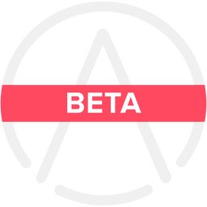
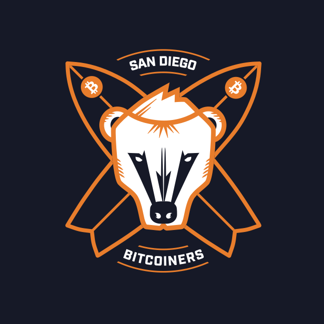

# StartOS registries

Every StartOS registry this project knows of. Generated from [`registries.toml`](registries.toml) and from what each registry says about itself; to add yours, see [CONTRIBUTING.md](CONTRIBUTING.md).

> [!WARNING]
> Being listed here means only that the registry exists and answered. **No registry is vetted or endorsed.** Adding a registry to StartOS trusts its signing keys for packages. See the [disclaimer](DISCLAIMER.md).

_Checked 2026-11-20. St (status): ✅ answered · ⚠️ unreachable at last check (last known data kept). Svcs: services installable from that registry. Categories: services in each, as the registry assigns them._

| | Registry | Run by | Trusted signers | Svcs | Categories | St |
|---|---|---|---|---|---|---|
|  | **Start9 Registry** [https://registry.start9.com/](https://registry.start9.com/) The primary registry for StartOS, run by Start9. Every service here is **maintained**, **recommended**, and **supported** by Start9. | Start9 | Start9, drbonez, matthill | 95 | AI&nbsp;(5), Bitcoin&nbsp;(18), Developer&nbsp;Tools&nbsp;(5), Files&nbsp;and&nbsp;Productivity&nbsp;(39), Finance&nbsp;(4), Media&nbsp;(14), Networking&nbsp;(6), Nostr&nbsp;(2), Social&nbsp;(13) | ✅ |
|  | **Start9 Beta Registry** [https://beta-registry.start9.com/](https://beta-registry.start9.com/) Pre-release builds of the services in the Start9 Registry. Report what you find in the [service testing room](https://matrix.to/#/#dev-service-testing:matrix.start9labs.com) on Matrix. | Start9 | Start9, drbonez, matthill | 96 | — | ✅ |
|  | **Start9 Community Registry** [https://community-registry.start9.com/](https://community-registry.start9.com/) The open registry for StartOS. Each service is maintained by its own developer. To list a service of your own, follow the [packaging guide](https://docs.start9.com/packaging); help is in the [service packaging room](https://matrix.to/#/#dev-service-packaging:matrix.start9labs.com) on Matrix. | Start9 | Start9, drbonez, matthill | 100 | AI&nbsp;(7), Bitcoin&nbsp;(41), Crypto&nbsp;(13), Files&nbsp;and&nbsp;Productivity&nbsp;(17), Finance&nbsp;(2), Media&nbsp;(7), Networking&nbsp;(7), Nostr&nbsp;(8), Social&nbsp;(5) | ✅ |
|  | **Start9 Community Beta Registry** [https://community-beta-registry.start9.com/](https://community-beta-registry.start9.com/) Pre-release builds of the services in the Community Registry. Report what you find in the [service testing room](https://matrix.to/#/#dev-service-testing:matrix.start9labs.com) on Matrix. | Start9 | Github Actions, Start9, drbonez, matthill | 109 | — | ✅ |
|  | **PaulsCode** [https://start9.paulscode.com/](https://start9.paulscode.com/) _No description provided by the registry owner._ | 3rdParty | — | 21 | AI&nbsp;(2), Bitcoin&nbsp;(14), Data&nbsp;(1), Developer&nbsp;Tools&nbsp;(2), Featured&nbsp;(13), Lightning&nbsp;(2) | ✅ |
|  | **registry.testnet4.info** [https://registry.testnet4.info/](https://registry.testnet4.info/) Maintained by [remcoros](https://github.com/remcoros). Personal StartOS registry with general services and testnet4 packages. Support is best-effort through the issue tracker linked by each package. | 3rdParty | github.com/remcoros | 15 | Bitcoin&nbsp;(11), Mining&nbsp;(2), Networking&nbsp;(2), Testnet&nbsp;4&nbsp;(2), Wallets&nbsp;(3) | ✅ |
|  | **Atoll Registry** [https://start9.bobodread.com/](https://start9.bobodread.com/) _No description provided by the registry owner._ | 3rdParty | — | 11 | AI&nbsp;(2), Files&nbsp;and&nbsp;Productivity&nbsp;(3), Lighting&nbsp;(1), Media&nbsp;(1), Networking&nbsp;(1) | ✅ |
|  | **start9.mempool.guide** [https://start9.mempool.guide/](https://start9.mempool.guide/) _No description provided by the registry owner._ | 3rdParty | horizon, kyle | 8 | Bitcoin&nbsp;(3) | ✅ |
|  | **SpacesOps Registry** [https://registry.spacesops.com/](https://registry.spacesops.com/) _No description provided by the registry owner._ | 3rdParty | — | 2 | — | ✅ |
|  | **zsapping.net** [https://registry.zsapping.net/](https://registry.zsapping.net/) _No description provided by the registry owner._ | 3rdParty | — | 2 | — | ✅ |
|  | **SD Bitcoiners Registry** [https://registry.sdbitcoiners.com/](https://registry.sdbitcoiners.com/) _No description provided by the registry owner._ | 3rdParty | — | 1 | — | ✅ |
|  | **h0mer-registry** [https://registry.start9.pl/](https://registry.start9.pl/) _Did not answer; description unknown._ | 3rdParty | — | — | — | ⚠️ |
